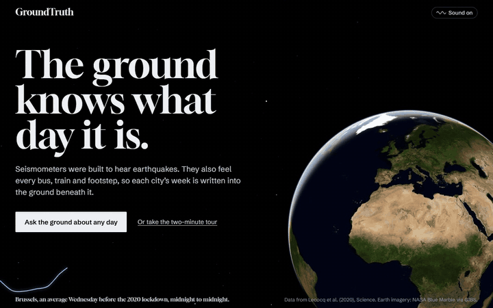
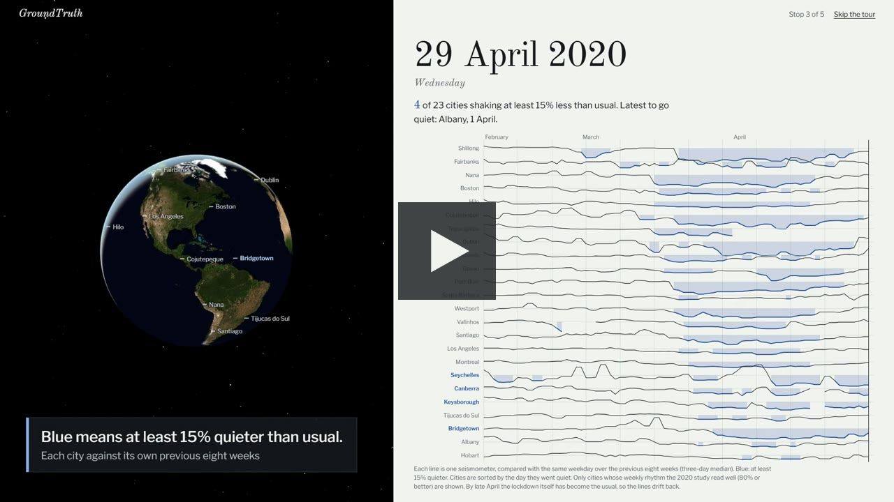
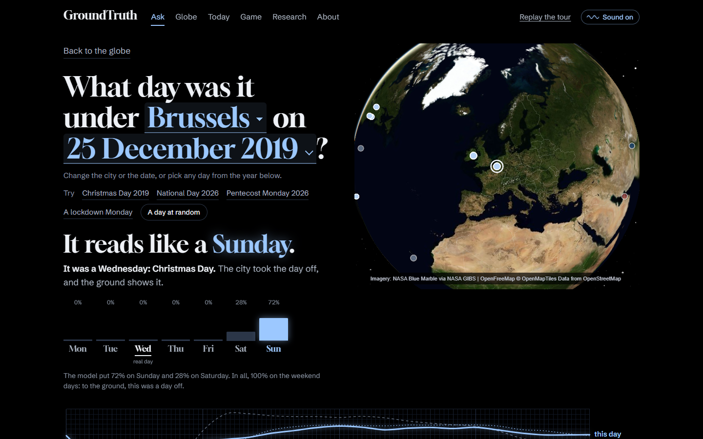
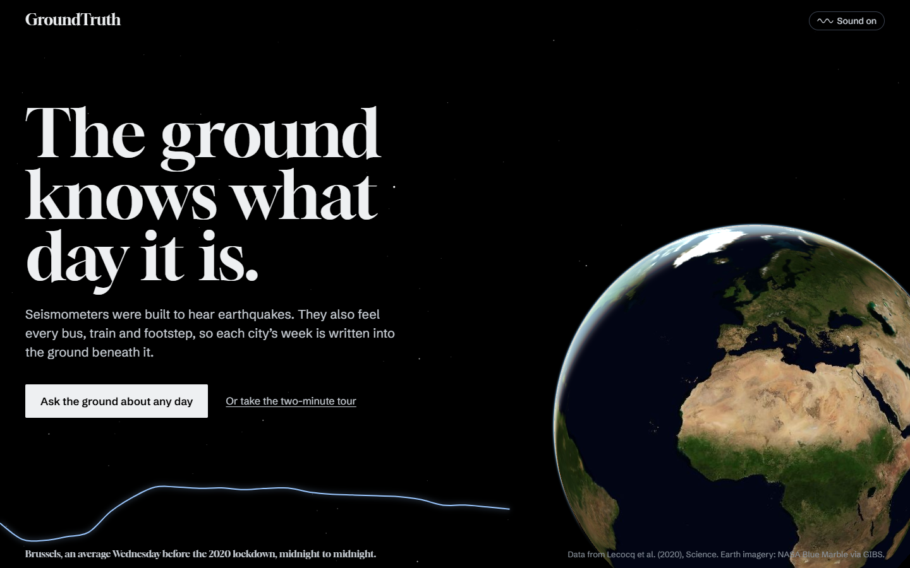
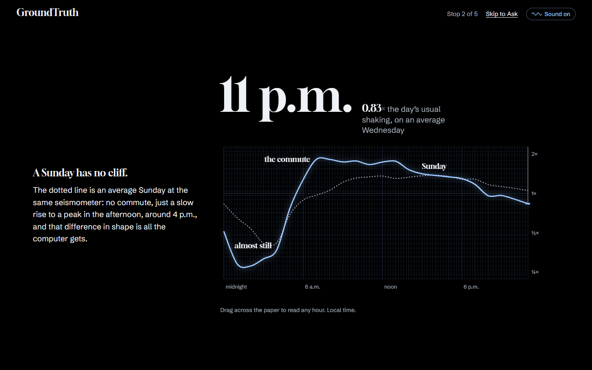
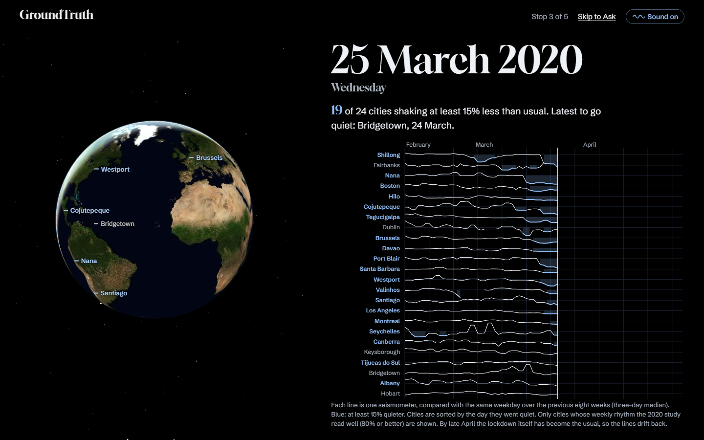
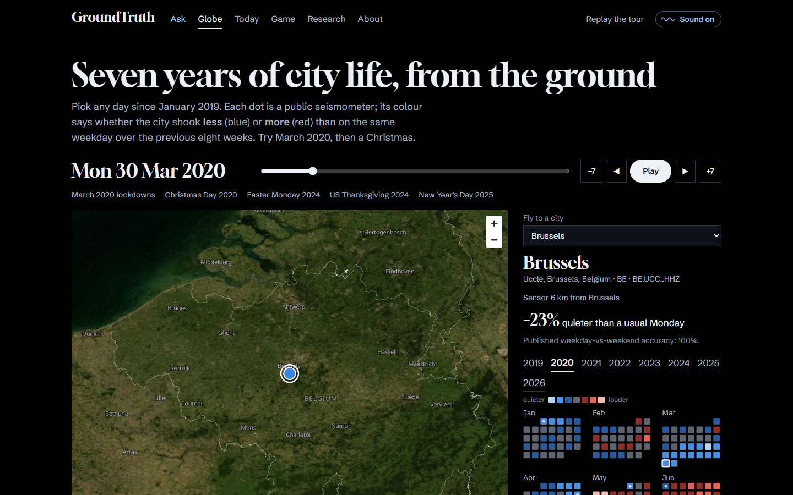
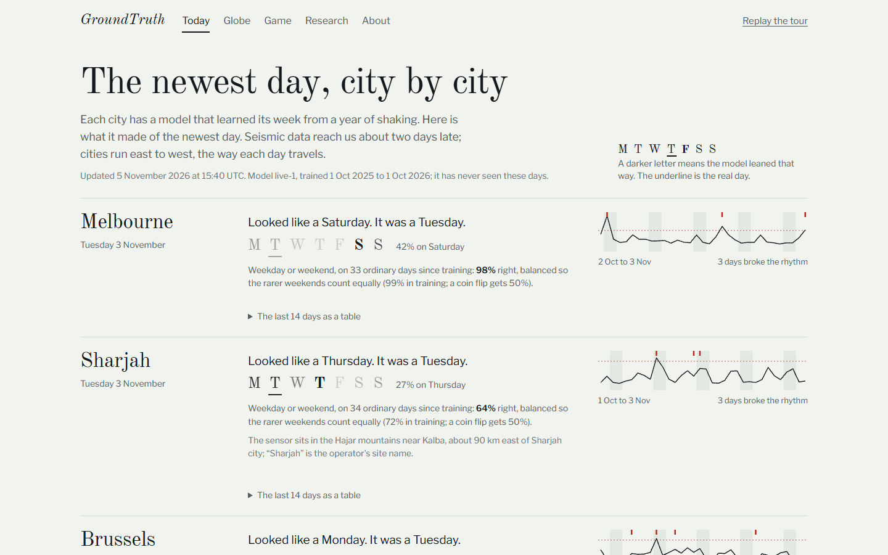
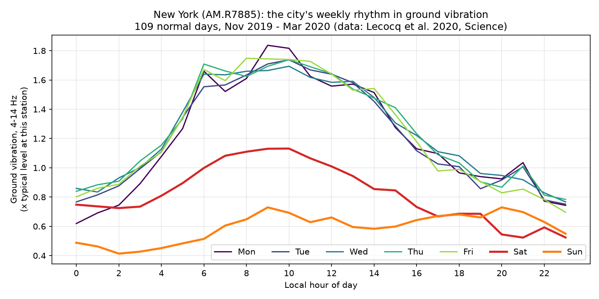
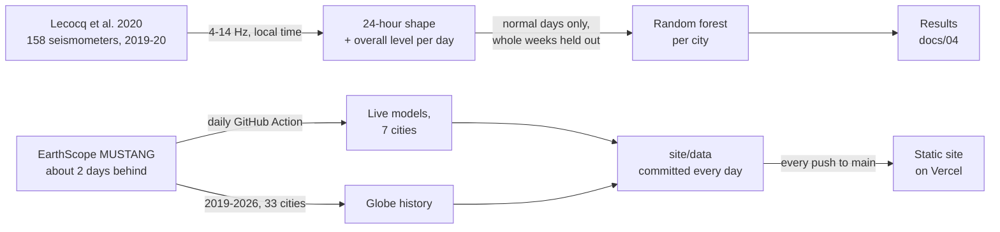

<div align="center">

# GroundTruth

**The ground knows what day it is.**
Seismometers built to hear earthquakes also hear cities. We read the day of the week,
and the days that break a city's rhythm, from real seismic noise alone.

[](https://groundtruth-seismic.vercel.app/)


[-15181c?style=flat-square)](LICENSE)



**[Ask the ground about any day](https://groundtruth-seismic.vercel.app/globe.html#ask/BE.UCC..HHZ/2019-12-25)** · **[Take the tour](https://groundtruth-seismic.vercel.app/)** · **[Watch the 2-minute video](https://groundtruth-seismic.vercel.app/watch.html)** · **[Open the globe in March 2020](https://groundtruth-seismic.vercel.app/globe.html#2020-03-23)** · **[See today's cities](https://groundtruth-seismic.vercel.app/today.html)** · **[Play the game](https://groundtruth-seismic.vercel.app/game.html)**

</div>

---

> No earthquake keeps office hours. Only people do.

Traffic, trains, footsteps and machinery shake the ground by a few tens of nanometres.
Seismometers record that shaking continuously, everywhere, for free. This project uses
**real recordings from 158 seismometers worldwide** to train machine-learning models
that (1) read the **day of the week** off one day of ground vibration, and (2) flag days
that **break a city's normal rhythm**: holidays, lockdowns, disruptions.

It works. A random forest tells weekdays from weekends with **95% median accuracy**
across 149 cities, names the exact weekday **3× better than chance**, and, never
having seen a holiday in training, calls **76% of weekday public holidays a
"weekend"** (vs 6% of ordinary weekdays), including Thanksgiving in New York and
All Saints' Day in Brussels. The same method on **current data (Oct 2025 – Sep 2026)**
reads weekday vs weekend at 98–100% in Brussels, Los Angeles, Melbourne, Dublin and
Montreal. And given a week of shaking, it names **the exact weekday** at a median of **96%**
across 33 cities (Result 17, pre-registered).

> Course project for Foundations of Data Science, BITS Pilani, presented 22 Sep 2026.
> Registered title: *Learning Urban Activity Rhythms from Ambient Seismic Noise for
> Anomaly-Based Disruption Detection*.

**Everything here uses real, published data. There is no synthetic data in this project.**

## Watch the 2-minute video

<a href="https://groundtruth-seismic.vercel.app/watch.html"></a>

A captioned walk through the live site, recorded from it: one day under Brussels, Ask the
ground on Christmas Day 2019, March 2020 city by city, the time-travel globe and the Today
page. It runs 2 min at 1080p with 9 chapters. The captions are in the picture and in the
[subtitle file](site/media/groundtruth-demo.srt); the sound is the site's own drone,
synthesised, with a soft whoosh between scenes. You can also
[download the MP4](https://groundtruth-seismic.vercel.app/media/groundtruth-demo.mp4).
The video is rebuilt from the live site by the code in `video/`.

## The site

- **A two-minute tour on the front door.** The Earth turns in the real night sky while a
  pen draws Brussels' average Wednesday along the bottom. Scroll, and the pen draws the
  day hour by hour, then the Sunday beside it. Then March 2020: one line per city on a
  drum record, turning blue as each city goes quiet. Then a quiz: one real day, weekday
  or weekend, against the model. Every number in it is computed in the browser from the
  site's data files. A skip link is always there, and returning visitors start at the
  globe.
- **Ask the ground.** Pick any of 33 cities and any day from 2019 to 2026, from a sentence
  or from the city's year laid out week by week. The Earth flies to the city, that day's
  shaking draws as a glowing pen line, and the model answers in two steps: weekday or
  weekend, from that day alone (97% at the median city), then which day, from the week
  around it (96%). Christmas 2019 in Brussels reads as a day off from the day alone, and as
  a Wednesday from the week: a Wednesday that looked like a Sunday. Every guess comes from
  a model that never trained on that day's week (Results 16 and 17).
- **Time-travel globe.** Any day since January 2019 for 33 cities, each coloured against
  the same weekday over its previous 8 weeks, on NASA satellite imagery with every
  naked-eye star at its real position. Click a city for its whole year as a calendar.
  Links are shareable, like `globe.html#2020-03-23/BE.UCC..HHZ`.
- **Today.** Every day a GitHub Action downloads yesterday's seismic noise for 7 cities,
  guesses the weekday, and flags days that broke the city's rhythm. Every day shown is
  one the model never trained on. Below it, **18 predictions committed before the day**
  and graded automatically.
- **Guess the day.** One real day of shaking; pick the weekday, then see what the model
  said.
- **Research map.** All 158 seismometers of the 2020 study, coloured by how well each
  reads a weekday, and which frequency bands carry the rhythm.
- **Honest labels.** A station is named after where its sensor actually is when that is
  more than 20 km from the city the paper lists ("Valinhos (near Campinas)").

<p align="center">
  
  
  
  
  
  

</p>

## The evidence, in one picture



One Raspberry Shake seismometer in New York, 113 normal days. Weekdays (cool colours)
share a sharp commute-shaped curve. Saturday (red) sits below it. Sunday (orange) is
lowest and starts latest. The weekly rhythm of a city, measured through the ground.

## How it works



1. Take the 4–14 Hz band, the frequencies where human activity lives.
2. Convert every timestamp to the station's **local** time (rush hour isn't 8 a.m. UTC).
3. Reduce each day to 24 hourly medians: the day's **shape** (24 numbers) plus its
   overall **level** (1 number).
4. Train a random forest on **normal days only**, holding out whole weeks for testing.
5. Predict: weekday vs weekend, and exact day of week.
6. Flag any day whose 25 features sit beyond the 95th percentile of that station's
   normal days: **disruption detection**, with no labels required.

Full detail in [`docs/03-methodology.md`](docs/03-methodology.md).

## What we show, and what we don't claim

| We show | We don't claim |
|---|---|
| Which day a city's ground looks like, on weeks the model never saw | Why a day was quiet: the ground shows that a city slowed down, not the reason |
| 95% median weekday vs weekend across 149 cities | That it works everywhere: the control stations (Mammoth Lakes, the Kalahari, Puerto Williams) sit at or near chance, and one-day-weekend stations (La Paz, Nepal) show no weekly signal |
| 76% of weekday public holidays read as a "weekend" | Regional holidays: calendars are national only, so Quebec's and Victoria's are missed |
| The 2020 lockdown quieting, reproduced from a second data source | Anything about individual people: the signal is a whole neighbourhood's vibration, summarised per hour |
| A pre-registered natural experiment (the UAE's 2022 weekend change) | More than it is: one station and one change |
| Live days scored by models that never trained on them | A live feed: MUSTANG data arrives about 2 days late, and stations go offline |


---

## Start here

**If you have 2 minutes** → read this page, then look at
[`docs/04-results.md`](docs/04-results.md).

**If you're new to machine learning** → [`docs/05-ml-primer.md`](docs/05-ml-primer.md)
explains every concept used here, with this project as the running example. No prior
knowledge assumed.

**If you want to run it** → [Quick start](#quick-start) below. About 15 minutes.

**If you're preparing the presentation** →
[`docs/06-presentation-guide.md`](docs/06-presentation-guide.md) has a slide-by-slide
plan, speaker notes and the questions to expect.

**If you're an AI coding agent picking this up** → read
[`CLAUDE.md`](CLAUDE.md) first. It has the rules, the state of the project and the
gotchas already solved.

---

## Documentation map

| Document | What's in it |
|---|---|
| [`docs/01-concept.md`](docs/01-concept.md) | The idea, the physics, why this is a good project, what we claim and don't |
| [`docs/02-data-and-sources.md`](docs/02-data-and-sources.md) | Exact dataset provenance, the three papers, how to download the data |
| [`docs/03-methodology.md`](docs/03-methodology.md) | Features, models, and every safeguard against cheating |
| [`docs/04-results.md`](docs/04-results.md) | All results with plots, the control group, limitations |
| [`docs/05-ml-primer.md`](docs/05-ml-primer.md) | Machine learning from scratch, explained through this project |
| [`docs/06-presentation-guide.md`](docs/06-presentation-guide.md) | Slide order, talking points, expected questions |
| [`docs/07-build-log.md`](docs/07-build-log.md) | Honest record of how this was built, including the wrong turn and every bug |
| [`docs/08-roadmap.md`](docs/08-roadmap.md) | What to do next, ordered by value for effort — including subtracting the learned human-noise floor to make small earthquakes detectable in cities (future work, not implemented) |
| [`docs/09-presentation-script.md`](docs/09-presentation-script.md) | Proposal presentation script — 3 slides, 3 speakers, Q&A. Deliberately contains no classifier results |
| [`docs/10-work-log.md`](docs/10-work-log.md) | Running log of the recent-data extension (post-presentation work) |
| [`docs/11-data-guide.md`](docs/11-data-guide.md) | Where live seismic data lives (FDSN, EarthScope, MUSTANG, Raspberry Shake, EIDA), how fresh it is, how we plan to use it |
| [`docs/12-master-plan.md`](docs/12-master-plan.md) | Master brief: semester deliverables (the five promises) and the City Pulse tool, phase by phase |
| [`docs/13-final-report.md`](docs/13-final-report.md) | **The final written report**: question, data, method, every headline result, limits, ethics |
| [`docs/14-uae-preregistration.md`](docs/14-uae-preregistration.md) | The pre-registered UAE weekend experiment, frozen before any data was downloaded, then its results |

---

## Headline results

All scores are out-of-sample, with **whole weeks held out** (see
[methodology](docs/03-methodology.md)).

| Result | Number | Chance |
|---|---|---|
| Weekday vs weekend, median over 149 stations | **94.9%** balanced accuracy | 50% |
| Exact day of week, median | **47.3%** | 14.3% |
| Exact day of week, best station (Dombås, Norway) | **73.9%** | 14.3% |
| One global model, tested only on **cities it never saw** | **83.0%** | 50% |
| Weekday public holidays the model calls "weekend" (never trained on any) | **75.6%** (n=634) | vs 5.5% of ordinary weekdays |
| Finding holidays by the model's *confusion*, PR-AUC (median per station) | **0.63** | 0.04 |
| Shape vs loudness alone, exact day (median gain, 141 of 149 stations gain) | **+17 pp** | — |
| Public-holiday days flagged as anomalous | **46.2%** | 5% by design |
| Lockdown days flagged as anomalous | **34.5%** | 5% by design |
| **Ask the ground**, 2019–2026, 33 stations: weekday vs weekend from one day, median (Result 16) | **97.1%** | 50% |
| Ask: exact day of week from one day, median over 33 stations, 81,709 days | **55.2%** | 14.3% |
| Ask: weekday public holidays read as a weekend, median station | **69%** (n=2,102) | vs 2.3% of ordinary weekdays |
| Exact weekday from one day, 3 frequency bands, median over 33 stations (Result 17) | **56.7%** | 14.3% |
| Exact weekday given **the 7 days around it**, median over 33 stations (Result 17) | **96.1%** | 14.3% |
| One day, more data / all cities in one model / more training rounds (Result 18) | 56.7% / 50.4% / 56.5% | no gain past ~1,600 days |

Showcase cities: New York `AM.R7885` (100.0% / 66.1%), Athens `HL.ATH` (100.0% / 69.6%),
Brussels `BE.UCC` (100.0% / 47.8%).

**The control group:** seismometers in Mammoth Lakes, the Kalahari and Puerto Williams
score at or near chance — few people, little signal — and accuracy rises with
population density (Spearman ρ = 0.39, p < 10⁻⁶). And when weekends are labelled
correctly per country, the Friday-weekend stations jump (Jeddah 53% → 90%, Amatzia
73% → 96%, Salfit 75% → 98%). A model trained only on Saturday–Sunday cities calls
Salfit's and Amatzia's *Fridays* "weekend" and their *Sundays* working days.

**A pre-registered natural experiment:** when the UAE moved its weekend on 1 Jan 2022,
Sunday at a seismometer in Sharjah got **20% quieter** relative to Mon–Thu (exact
permutation p = 0.003), with no such change in a placebo year. Hypothesis committed
before the data was downloaded: [`docs/14`](docs/14-uae-preregistration.md).

**The live data source sees the same lockdown:** seven years of MUSTANG history
(2019–2026) for 6 cities reproduces the published 2020 lockdown quieting within 0.7
percentage points at every one (e.g. Dublin −40.6% published vs −40.7%), a check
written down before the download (`docs/04` Result 14).

*Weekends follow each country's own calendar, official public holidays are excluded
from training, and the forest uses class weighting (labels corrected 2026-11-03,
weighting added 2026-11-04; see `docs/04-results.md`).*

---

## Quick start

```bash
git clone https://github.com/aaaditt/groundtruth.git
cd groundtruth
pip install -r requirements.txt

./run_all.sh          # reproduces everything (~30 min); the data is already in the repo

pip install -r requirements-dev.txt
pytest -q             # ~10 s: local time, DST, weekend rules, CV leak checks, all on real data
```

GitHub Actions runs the tests on every push, and also **rebuilds the dataset from the
raw recordings on a clean Linux machine and checks it matches the committed file**:
every label identical, every number within 1e-9 (`.github/workflows/tests.yml`).

`run_all.sh` is just these steps in order — run them individually if you prefer
(on Windows, use Git Bash or run the Python lines one at a time):

```bash
python src/get_data.py                              # no-op: the dataset is committed under data/external/
python src/build_dataset.py                          # -> data/processed/daily_features.csv
python src/train_stations.py                         # per-city models (~5-8 min)
python src/train_global.py                            # one model, tested on unseen cities
python src/showcase_city.py --station AM.R7885       # slide plots for one city
python src/detect_disruptions.py --station AM.R7885  # holiday / lockdown anomaly detection
```

**Both datasets are committed.** The raw recordings are vendored under
`data/external/` (see [`data/external/PROVENANCE.md`](data/external/PROVENANCE.md)), so
there is no download step — clone the repo and everything runs. The processed table
(`data/processed/daily_features.csv`, 158 stations × ~180 days) is committed too, so you
can skip straight to training if you just want to play with the models.

This makes the clone large (~113 MB). The trade was deliberate: the exact bytes every
result was computed from are pinned in history rather than fetched from an upstream
repository that could move.

### The live demo

```bash
python src/predict.py --station AM.R7885 --date 2019-11-28   # Thanksgiving -> "Sunday" (63%)
python src/predict.py --station AM.R7885 --date 2019-12-25   # Christmas    -> "Sunday" (97%)
python src/predict.py --station AM.R7885 --date 2020-02-12   # ordinary Wednesday
python src/predict.py --station BE.UCC   --date 2019-11-01   # All Saints' Day, Brussels
```

The model is retrained without the week containing the date you ask about, so every
answer is a genuine blind guess.

### Rebuild the site's media

```bash
pip install playwright && playwright install chromium   # plus ffmpeg on PATH
python scripts/screenshots.py      # the README screenshots, from the live site -> assets/
python scripts/record_demo.py      # the README GIF -> assets/demo.gif (kept under 8 MB)
python video/record_scenes.py      # the video's scenes at 1080p, from the live site
python video/assemble.py           # -> site/media/: MP4, subtitles, chapters, poster
cd site && python -m http.server 8765   # the site locally: http://localhost:8765
```

The site is plain static files in `site/`, served by Vercel (`vercel.json`, no build
step). Every push to `main` redeploys it, including the daily data commit.

Other good stations: `HL.ATH` (Athens), `BE.UCC` (Brussels), `FR.CURIE` (Paris),
`CN.MNTQ` (Montreal), `CH.SGEV` (Geneva), `NS.DOMB` (Dombås). Full list with scores in
[`outputs/station_scores.csv`](outputs/station_scores.csv).

---

## Repository layout

```
groundtruth/
├── README.md                    you are here
├── CHANGELOG.md                 what changed in each version
├── LICENSE                      MIT, for the code (the data keeps its own licences)
├── CLAUDE.md                    instructions for AI coding agents working on this repo
├── requirements.txt
├── run_all.sh                    reproduce everything
├── vercel.json                   hosting: serve site/ as static files, always revalidated
│
├── assets/                       README GIF and screenshots (scripts/ rebuilds them)
├── scripts/                      screenshots.py, record_demo.py
├── video/                        the demo video: captions.json, cards.html, record_scenes.py, assemble.py
│
├── docs/
│   ├── 01-concept.md             the idea and the physics
│   ├── 02-data-and-sources.md    dataset provenance + papers
│   ├── 03-methodology.md         features, models, honest evaluation
│   ├── 04-results.md             all results, plots, limitations
│   ├── 05-ml-primer.md           ML explained for beginners
│   ├── 06-presentation-guide.md  slides, talking points, Q&A
│   ├── 07-build-log.md           how this was built, mistakes included
│   ├── 08-roadmap.md             next steps
│   └── 09-presentation-script.md proposal talk script (no classifier results)
│
├── groundtruth/                 the reusable package (import groundtruth)
│   ├── features.py               15-min RMS -> 24-hour daily features (local time)
│   ├── calendars.py              weekends + public holidays per country (cited)
│   ├── models.py                 the model, the CV splitter, dataset loading
│   ├── stations.py               loads + checks config/stations.yaml
│   ├── client.py                 polite HTTP client (rate limit, retries, OS certificates)
│   ├── mustang.py                recent data: MUSTANG spectra -> 4-14 Hz displacement RMS
│   ├── live.py                   per-station live models on 12 months of MUSTANG data
│   ├── ask.py                    out-of-fold weekday guesses for every city-day (Result 16)
│   ├── weekday.py                exact-weekday experiment: 3 bands, half-hours, a week (Result 17)
│   └── pulse.py                  scores new days for the dashboard (reuses detect.py)
│
├── site/                         the static website (served by Vercel)
│   ├── index.html, tour.js       the front door: a scrolling tour of the data
│   ├── today.html, today.js      the newest day per city + predictions board
│   ├── game.html, game.js        "guess the day" against the model
│   ├── globe.html, globe.js      time-travel globe, 2019-2026 (data from src/history.py)
│   ├── ask.js                    Ask the ground, on the globe page (data/ask/, src/ask.py)
│   ├── sound.js                  the site's sound, synthesised with Web Audio
│   ├── research.html, research.js  158-station map + band chart
│   ├── watch.html, watch.js      the 2-minute demo video, with chapters
│   ├── media/                    the video, its subtitles, chapters and poster
│   ├── about.html, common.js, style.css
│   └── data/                     pulse.json + pulse_days.csv, updated daily by
│                                 .github/workflows/pulse.yml (the open dataset)
│
├── config/
│   ├── weekends.csv              weekend days per country, with source + start date
│   ├── event_checks.csv          news checks for the most confusing days, with sources
│   ├── country_fixes.csv         corrections to Table S1 country codes
│   └── stations.yaml             station roster for recent/live data (Stage 3)
│
├── tests/                        pytest on REAL data excerpts (no synthetic data)
│   ├── make_fixtures.py          cuts the excerpts from data/external, verbatim
│   └── fixtures/                 two weeks of New York incl. the DST switch
│
├── src/                          experiment scripts: every reported number comes from here
│   ├── get_data.py               download the Lecocq et al. 2020 dataset
│   ├── build_dataset.py          all stations + metadata + period labels
│   ├── train_stations.py         per-city models, week-held-out cross-validation
│   ├── train_global.py           one model, tested on unseen cities
│   ├── showcase_city.py          presentation plots for one city
│   ├── detect_disruptions.py     holiday / lockdown anomaly detection
│   ├── predict.py                live demo: one station, one date, one guess
│   ├── class_weight_check.py     before/after for class weighting
│   ├── shape_vs_level.py         promise 2: does the day's shape beat loudness?
│   ├── score_days.py             honest per-day scores for promises 3-4
│   ├── confusion_detector.py     promise 3: model confusion as a holiday detector
│   ├── holiday_holdout.py        promise 4: held-out holidays by type
│   ├── transfer.py               promise 5: cross-region transfer and its failures
│   ├── uae_experiment.py         pre-registered UAE weekend experiment (needs internet)
│   ├── train_live.py             live models, Oct 2025 - Sep 2026 (needs internet)
│   ├── pulse.py                  the daily dashboard job (needs internet)
│   ├── band_test.py              which frequency bands carry the rhythm (MUSTANG cache)
│   ├── history_pilot.py          2019-2026 history + lockdown cross-check (needs internet)
│   ├── history.py                33-station history for the globe (needs internet, ~2.5 GB)
│   ├── ask.py                    every city-day guessed out of fold, for Ask (from the cache)
│   ├── export_site_research.py   data for the research map and the game
│   ├── check_places.py           sensor-to-city distances for honest map labels (GeoNames)
│   ├── export_stars.py           the globe's night sky (Yale Bright Star Catalogue)
│   ├── survey_mustang.py         which stations have recent data (needs internet)
│   ├── validate_route_a.py       recent-data route vs the published data (needs internet)
│   ├── weekend_signature.py      cross-country weekend analysis (no ML)
│   └── make_presentation_plots.py  the four proposal figures (no ML)
│
├── data/
│   ├── external/                 raw source dataset, committed (~333 MB; see PROVENANCE.md)
│   └── processed/
│       └── daily_features.csv    158 stations x ~180 days, 25 features each (committed)
│
└── outputs/
    ├── plots/                    all figures (presentation-ready)
    ├── tables/
    │   └── weekly_profiles.csv   per-station weekly profile, quietest day, inferred weekend
    ├── station_scores.csv        per-station accuracy for every station
    ├── global_model_unseen_city_scores.csv
    ├── disruption_summary.csv    holiday/lockdown detection rates per station
    └── daily_anomaly_scores.csv  every station-day with its anomaly score
```

---

## Team

Aadit Chandra, Aradhya Gupta and Shraddha Pradeep.

---

## Data, citation and licence

The seismic data is **not ours**. It comes from the official companion repository of:

> **Lecocq, T., Hicks, S. P., Van Noten, K., et al. (2020).** Global quieting of
> high-frequency seismic noise due to COVID-19 pandemic lockdown measures. *Science*,
> 369(6509), 1338–1343. doi:[10.1126/science.abd2438](https://doi.org/10.1126/science.abd2438)
> — https://github.com/ThomasLecocq/2020_Science_GlobalQuieting

Supporting literature: Díaz et al. (2017), *Scientific Reports* 7:15296; Groos & Ritter
(2009), *GJI* 179(2):1213. Full details and links in
[`docs/02-data-and-sources.md`](docs/02-data-and-sources.md).

If you use this repository, please cite Lecocq et al. (2020) for the data.

**Licence.** The code is released under the [MIT licence](LICENSE): `groundtruth/`,
`src/`, `tests/`, `scripts/`, `video/` and the website's HTML, CSS and JavaScript. The
data keeps its sources' terms, and the MIT licence does not relicense it:

- **Lecocq et al. (2020) dataset:** EUPL v1.1, vendored verbatim under `data/external/`
  with its licence file. The tables we derive from it (`data/processed/`, `outputs/`,
  test fixtures and the 2020-study files in `site/data/`) stay under EUPL v1.1, with
  attribution. See [`data/external/PROVENANCE.md`](data/external/PROVENANCE.md).
- **EarthScope MUSTANG** (the live data and the 2019–2026 history): open data, cited per
  seismic network with DOIs in `docs/02`.
- **Earth imagery:** NASA Blue Marble: Next Generation, served by NASA GIBS (no
  copyright restrictions). **Stars:** Yale Bright Star Catalogue. **Places:** GeoNames
  (CC BY 4.0). **Map tiles:** OpenFreeMap, © OpenStreetMap contributors.
- **Typefaces:** Old Standard TT and Libre Franklin (SIL Open Font License).

A quiet day on the ground shows that a city slowed down, not why. Nothing here
identifies, locates or follows a person.

---

## Honest notes

- The published results use data ending in **May 2020**. A route to recent data
  (EarthScope's MUSTANG spectra, about 2 days behind real time) is built and
  **validated against the published data on 6 stations** (`docs/11-data-guide.md`)
  and used for one pre-registered experiment (`docs/14`). Live models for 7 stations
  are trained on Oct 2025 – Sep 2026 (`docs/04`, Result 11) and power the City Pulse
  dashboard (`site/`). Montreal and Puerto Williams have months of missing data.
- The UAE station II.UOSS is named "Univ. of Sharjah" but its official coordinates are
  ~90 km east of Sharjah city (`docs/14`, section 7).
- Public holidays are **national** calendars only; regional holidays are not excluded.
- Weekend labels follow a cited source per country, but involve judgement for
  Monday–Saturday countries (India, Mexico, ...). A few one-day-weekend stations
  (La Paz, three in Nepal) show no weekly signal even with class weighting.
- Splitting each day into shape + loudness is kept for cross-station comparability,
  not accuracy: raw hourly values do slightly better per station (`docs/04`, Result 6).
- Most of the top "most confusing" days in the showcase cities remain unexplained;
  only clusters with a candidate explanation were checked against news.
- Two of the three cited papers were read as abstracts and citation records, not in full.
- This project was built with AI assistance. The full process, including a discarded
  synthetic-data prototype and every bug along the way, is documented in
  [`docs/07-build-log.md`](docs/07-build-log.md).
