# 4. Results

All numbers below come from real data, produced by the scripts in `src/`, and are
reproducible with `./run_all.sh`. Every score is out-of-sample (see
`docs/03-methodology.md`, Step 5).

Dataset after cleaning: **158 stations, 28,749 station-days**. 149 stations had the
≥70 normal days required to train a per-station model.

> **Labels corrected 2026-11-03.** Weekends now follow each country's own calendar
> (Friday–Saturday in Saudi Arabia and Israel, Friday in Iran and Palestine, ...), and
> every official public holiday is removed from training and tested as a disruption.
>
> **Class weighting added 2026-11-04.** Rare classes, such as weekend days, now count
> as much as common ones in training, to match the balanced-accuracy metric. The
> before/after is in Result 5, and all numbers below use it. Old values are logged in
> `docs/10-work-log.md`.

---

## Result 1 — A seismometer can tell weekdays from weekends

Per-station models, 5-fold cross-validation holding out whole weeks:

| Task | Median across 149 stations | Chance |
|---|---|---|
| Weekday vs weekend (balanced accuracy) | **94.9%** | 50% |
| Exact day of week (accuracy) | **47.3%** | 14.3% |

**70% of stations (105) score ≥ 90%** on weekday vs weekend, and 19 score 100%.

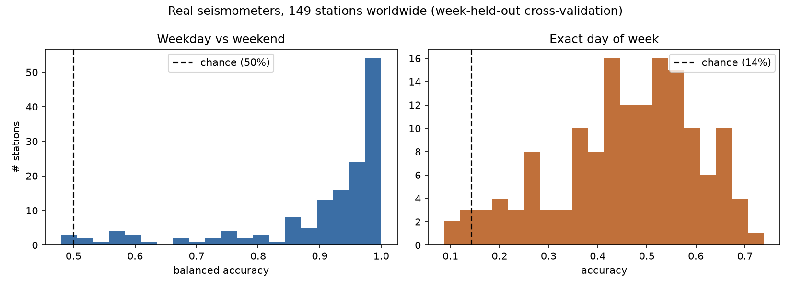

Stations scoring 100% on weekday/weekend include:
- Rundu (Namibia), Tegucigalpa, Warsaw, Chicago;
- Trondheim, Bergen, Milan, Naples;
- Bucharest, San José, Los Angeles, Barcelona;
- Paris (FR.CURIE), Geneva (CH.SGEV), Bern;
- Montreal (CN.MNTQ), Athens, Brussels and New York.

Best stations for exact day of week: Dombås 73.9%, **Athens 69.6%**, Albany 68.1%,
Chapinero (Bogotá) 68.1%, Geneva 67.5%, San José 66.7%.

### Correct weekends make the signal appear

The stations whose weekend labels changed show what wrong labels had been hiding:

| Station | Country | Weekend (correct) | Sat–Sun labels | Correct labels | + class weighting |
|---|---|---|---|---|---|
| `AM.RFBE4` | Saudi Arabia (Jeddah) | Fri–Sat | 52.7% | 85.2% | **90.2%** |
| `IS.AMAZ` | Israel (Amatzia) | Fri–Sat | 72.8% | 96.9% | **95.6%** |
| `GE.SALP` | Palestine (Salfit) | Fri | 74.6% | 95.8% | **98.1%** |
| `IN.PBA` | India | Sun | 72.3% | 87.6% | **89.9%** |

The model was right all along; the labels were wrong. This is direct evidence the
model tracks when people actually rest, not a fixed calendar pattern.

### The showcase cities

| Station | City | Sensor type | Weekday vs weekend | Exact day |
|---|---|---|---|---|
| `AM.R7885` | New York | Raspberry Shake (citizen) | 100.0% | 66.1% |
| `HL.ATH` | Athens | Professional network | 100.0% | 69.6% |
| `BE.UCC` | Brussels | Professional (paper author's own station) | 100.0% | 47.8% |

A ~$400 home seismometer in New York performs as well as research-grade instruments.
That is a good slide.

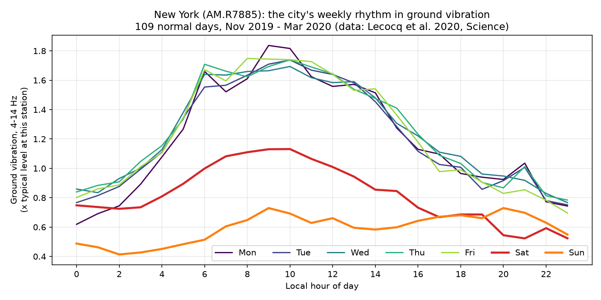

The New York plot is the core evidence, visible before any machine learning:
- **Monday to Friday** rise sharply from about 6 a.m. and stay high.
- **Saturday** is clearly lower.
- **Sunday** is lowest of all and rises latest.

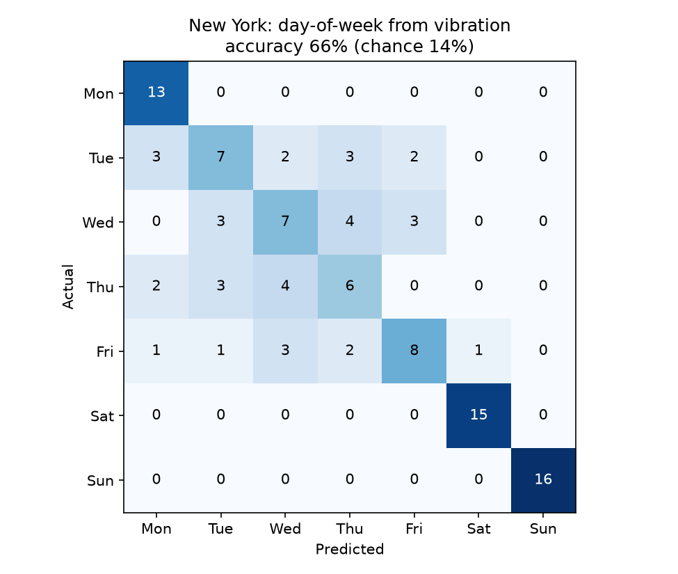

The confusion matrix shows the model's characteristic error: it rarely confuses a
weekday with a weekend, but often confuses Tuesday with Wednesday or Thursday. That is
exactly what you'd expect. Those days genuinely look alike to a seismometer, because
people behave the same way on them.

---

## Result 2 — The control group: few people, little signal

The bottom of the table is as informative as the top:

| Station | Location | Weekday vs weekend | Exact day |
|---|---|---|---|
| `NC.MLI` | Mammoth Lakes, USA (mountains) | 48.0% | 14.2% |
| `C1.MG01` | Puerto Williams, Chile (remote) | 56.4% | 8.7% |
| `BX.KOOLE` | Kule, Botswana (Kalahari) | 59.0% | 15.1% |

These sit at or near chance, as they must if we are measuring human activity rather
than some artefact of the method. **This is the project's built-in sanity check.**

Class weighting moved Puerto Williams and Kule a few points above 50%. The unweighted
model scored 50.1% and 51.7% there, mostly by answering "weekday" every time. Their
exact-day accuracy (9–15%) is still at chance (14.3%).

**One-day weekends are a real limit, but not the one we thought.** La Paz (Sunday-only
weekend) and the Nepal stations (Saturday-only) scored exactly 50.0% before, and we
blamed class imbalance. With class weighting the imbalance is gone, but they are still
near chance:

| Station | Before | After |
|---|---|---|
| La Paz | 50.0% | 54.3% |
| Pokhara | 50.0% | 52.0% |
| Gaindakot | 50.0% | 48.0% |
| Chitwan | 53.8% | 56.1% |

So at these stations the model finds no detectable weekly rest day. The imbalance was a
symptom, not the cause. (Myagdi, also in Nepal, does have a signal: 84.6%.)

The effect scales with how many people are around. Median weekday/weekend accuracy by
population-density third, against population density from Table S1 (printed by
`src/train_stations.py`):

| Density third | Median accuracy |
|---|---|
| Least dense | **92.6%** |
| Middle | **94.0%** |
| Densest | **98.1%** |

Spearman ρ = 0.39, p = 9.2 × 10⁻⁷, n = 149.

*Check added 2026-11-04:* Table S1 puts two stations in the wrong place (Nilore and
Davao; see `docs/02`), so their density values may be wrong too (Nilore, near Islamabad,
is listed at 2 people/km²). Leaving both out: ρ = 0.385, p = 1.5 × 10⁻⁶, n = 147. The
result does not depend on them.

---

## Result 3 — One model for cities it has never seen

`src/train_global.py` pools all normal days and is cross-validated by **station**, so
every test day comes from a city that contributed nothing to training.

| Task | Global model, unseen cities | Per-city models | Chance |
|---|---|---|---|
| Weekday vs weekend | **83.0%** | 94.9% | 50% |
| Exact day of week | **30.5%** | 47.3% | 14.3% |

Global-model figures are pooled over all test days. The median per unseen station is
88.0% for weekday vs weekend.

The weekly rhythm of human activity is **partly universal**. A model trained on other
cities transfers to a city it has never met and still beats chance decisively. But each
city has its own signature, and a local model is far better. Result 9 shows where
transfer fails.

---

## Result 4 — Disruption detection

Models trained **only on normal days**, then applied to public holidays, the Christmas
season and lockdown days they had never seen. Pooled over all station-days, 149
stations (`src/detect_disruptions.py`):

| | Normal days | Public holidays | Christmas season (non-holiday days) | COVID lockdown |
|---|---|---|---|---|
| Weekdays the model calls "weekend" | 5.6% (n=12,093) | **75.6%** (n=634) | 29.4% (n=1,270) | 26.1% (n=5,856) |
| Days flagged as anomalous | 5.3% *(≈5% by design)* | **46.2%** (n=705) | 16.5% (n=2,100) | **34.5%** (n=8,072) |

**Headline: on weekday public holidays the model said "weekend" 75.6% of the time,
against 5.6% for ordinary weekdays.** It never saw a holiday in training.

We report pooled rates because most stations have only 1–5 weekday public holidays
before lockdown. A per-station median then jumps between 0% and 100%: the per-station
medians are 4% / 100% / 22% / 15% for weekdays called weekend.

The pattern across holidays makes sense:

| Kind of holiday | Examples | Called "weekend" |
|---|---|---|
| Cities genuinely shut down | Christmas Day (n=136) | 86% |
| | New Year's Day (n=136) | 92% |
| | Thanksgiving (n=32) | 91% |
| | All Saints' Day (n=20) | 90% |
| Most businesses stay open (US federal) | Veterans Day (n=31) | 19% |
| | Martin Luther King Jr. Day (n=32) | 41% |

Result 7 breaks this down by holiday type.

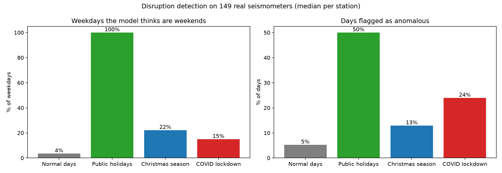

The ~5% normal-day flag rate is not a result. It is the threshold definition (95th
percentile of normal days). The result is that public holidays run at about 9× that
rate and lockdowns at about 7×.

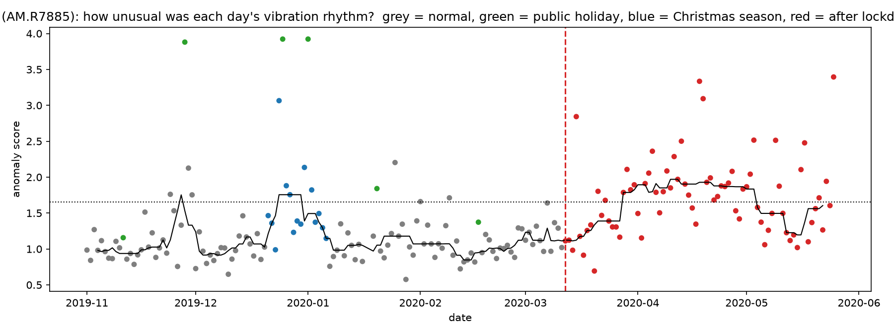

### Holidays discovered without being told

The anomaly score itself uses no calendar labels. Its five highest-scoring days outside
lockdown, per showcase city:

| City | Top anomalous days outside lockdown |
|---|---|
| New York | 1 Jan, 25 Dec, **Thanksgiving (Thu 28 Nov 2019)**, 24 Dec, Sat 25 Jan |
| Athens | 1 Jan, 25 Dec, **6 Jan (Epiphany)**, 26 Dec, Sat 28 Dec |
| Brussels | 1 Jan, 25 Dec, Sat 15 Feb, **1 Nov 2019 (All Saints' Day)**, Sat 29 Feb |

The top three or four in each city are official public holidays or Christmas Eve.

### Live demo results (`src/predict.py`)

| Station, date | Actual | Model's guess | Flagged? |
|---|---|---|---|
| New York, 12 Feb 2020 | Wednesday | Tuesday (27%), wrong but adjacent | No |
| New York, **28 Nov 2019** (Thanksgiving) | Thursday | **Sunday (63%)** | **Yes** |
| New York, **25 Dec 2019** | Wednesday | **Sunday (97%)** | **Yes** |
| Brussels, **1 Nov 2019** (All Saints') | Friday | **Sunday (52%)** | **Yes** |
| Athens, 1 Apr 2020 (lockdown) | Wednesday | Tuesday (45%) | **Yes** |

---

## Result 5 — Class weighting: before and after (`src/class_weight_check.py`)

The same forest, the same folds, with and without `class_weight="balanced"`
(`outputs/tables/class_weight_comparison.csv`):

| | Unweighted | Weighted |
|---|---|---|
| Weekday vs weekend, median | 94.6% | **94.9%** |
| Exact day, median | 47.0% | **47.3%** |
| Stations better by > 1 pp / worse by > 1 pp | — | 59 / 17 |
| Ordinary weekdays called "weekend" (false alarms) | 2.7% | 5.6% |
| Held-out holidays called "weekend" | 70.5% | 75.6% |

**Biggest gains:**

| Station | Unweighted | Weighted |
|---|---|---|
| Ocotepeque | 70% | **95%** |
| Tegucigalpa (`CU.TGUH`) | 76% | **92%** |
| Shillong | 74% | **88%** |

These are stations where a weekend signal existed but the unweighted forest
under-called it.

**Trade-off:** weighting makes the model more willing to say "weekend". It catches more
holidays, at twice the false-alarm rate on normal weekdays.

We adopted weighting because it matches the training objective to the balanced-accuracy
metric we report, a reason that holds before seeing any result. It was not picked for a
better score.

---

## Result 6 — Shape vs loudness (`src/shape_vs_level.py`)

Does the 24-hour **shape** of a day carry information beyond how **loud** it was? Four
feature sets, two model families, identical week-held-out folds, 149 stations. Median
[interquartile range]:

| Model | Task | Loudness only (1) | Shape only (24) | Both (25) | Raw hourly (24) |
|---|---|---|---|---|---|
| Random forest | weekday vs weekend | 83.0% [66–94] | 94.0% [84–98] | 94.9% [88–99] | **96.1%** [90–99] |
| Random forest | exact day | 30.2% [22–37] | 46.1% [36–55] | 47.3% [38–56] | **50.0%** [41–58] |
| Logistic regression | weekday vs weekend | 85.8% [69–95] | 95.2% [81–99] | 95.9% [87–99] | 96.0% [86–99] |
| Logistic regression | exact day | 29.9% [24–37] | 44.0% [34–53] | 44.7% [36–54] | 45.5% [37–54] |

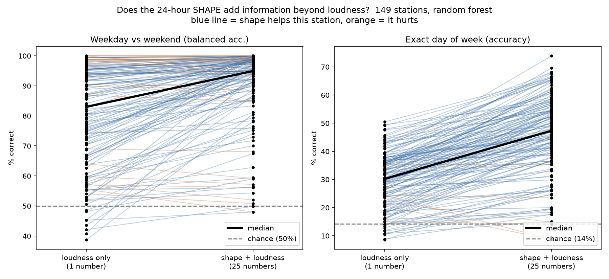

**Shape adds a lot over loudness alone** (random forest; paired Wilcoxon across
stations):

| Task | Median gain from adding shape | Stations gaining > 2 pp | Stations losing > 2 pp | p |
|---|---|---|---|---|
| Weekday vs weekend | **+5.5 pp** | 110 | 9 | 1.4 × 10⁻¹⁹ |
| Exact day | **+17.2 pp** | 141 | 3 | 7.6 × 10⁻²⁵ |

Logistic regression agrees: +5.3 and +12.8 pp. Loudness alone, what the field usually
measures, gets the exact day right 30% of the time; adding the shape takes it to 47%.

**But splitting the day into shape + loudness does not itself help.** The "raw hourly"
set has the same information, just not decomposed, and it does *slightly better* with
random forests: −0.5 pp for weekday vs weekend (p = 0.002) and −1.7 pp for exact day
(p = 3 × 10⁻⁵). For logistic regression the two are within 1 pp.

So the claim "shape carries information beyond loudness" holds. The claim "our
decomposition improves accuracy" does not.

We keep the decomposition anyway, for reasons other than accuracy:
- **It is the only form comparable across stations.** Stations record in different
  units (metres vs nanometres). Raw hourly values would make the global model, the
  transfer study and the MUSTANG validation meaningless.
- **It stops a model learning a station's loudness instead of its rhythm.**

---

## Result 7 — Holiday hold-out by type (`src/holiday_holdout.py`)

Every public holiday on a working day, never in training, against ordinary working days
scored week-held-out. P(Sunday) is for Saturday–Sunday-weekend countries only.

| Group | Station-days | Called "weekend" | Mean P(Sunday) |
|---|---|---|---|
| Ordinary working days | 12,041 | 5.5% | 0.04 |
| **All public holidays** | 634 | **75.6%** | **0.47** |
| New Year (incl. lunar and Nepali new years) | 150 | 90.0% | 0.62 |
| Christmas & Easter | 195 | 84.6% | 0.56 |
| Other religious | 86 | 67.4% | 0.50 |
| Civic / national | 190 | 56.8% | 0.26 |
| Unclassified ("Substitute Holiday", ...) | 13 | 100% | 0.36 |
| Bridge days (not official; working day between a holiday and the weekend) | 117 | 48.7% | 0.18 |
| Bridge days outside 21 Dec – 6 Jan | 52 | 44.2% | 0.17 |

**Headline for the report:** *On held-out public holidays the model said "weekend"
75.6% of the time, vs 5.5% for ordinary weekdays.* A held-out holiday gets an average
P(Sunday) of 0.47, against 0.04 for an ordinary weekday. (Result 4 says 5.6%, n=12,093.
The difference is the 52 bridge days outside 21 Dec – 6 Jan, which this table counts
separately.)

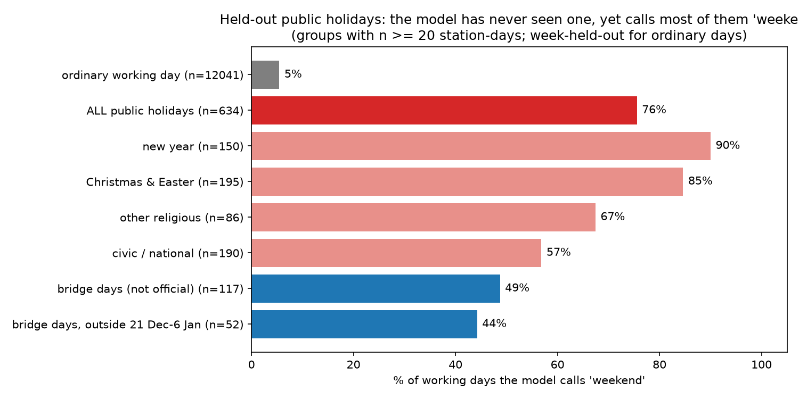

The ordering is the useful part:
- **Big shared holidays look most like Sunday:** New Year and Christmas/Easter.
- **Civic holidays look least like it.** Many people work on Veterans Day or MLK Day.
- **Bridge days come out half-way.** No law closes the city then, but many people take
  the day off; the Friday after Thanksgiving is the largest group (33 stations, 67%
  called weekend).

Types come from keyword rules on the holiday names (`TYPES` in the script). Every name
was checked, and only generic names ("Substitute Holiday", "Public Holiday") stay
unclassified. The religious/civic line is a judgement call for days like New Year.

---

## Result 8 — Confusion as a disruption detector (`src/confusion_detector.py`)

**Confusion** = 1 − P(true day of week). How surprised is the model by this day? It is
compared with the anomaly score (distance from normal days).

Both are computed the same honest way (`groundtruth/detect.py`):
- normal days are scored by models and statistics fitted on *other* weeks;
- each flags days above the 95th percentile of that station's normal days.

Ground truth is the official public holidays. Evaluation days run up to lockdown, with
the 21 Dec – 6 Jan "festive" days left out, since they are neither normal nor official.

| Days evaluated | Detector | Precision | Recall | PR-AUC (chance) |
|---|---|---|---|---|
| All days (147 stations) | **confusion** | 0.33 | 0.67 | **0.63** (0.04) |
| | anomaly | 0.25 | 0.50 | 0.33 |
| Working days only | **confusion** | 0.33 | 0.83 | **0.68** (0.05) |
| | anomaly | 0.40 | 0.50 | 0.44 |

Medians per station. PR-AUC confusion vs anomaly: confusion is higher at 110 of 147
stations (paired Wilcoxon p = 2 × 10⁻¹⁴), and at 91/147 on working days only
(p = 6 × 10⁻⁸).

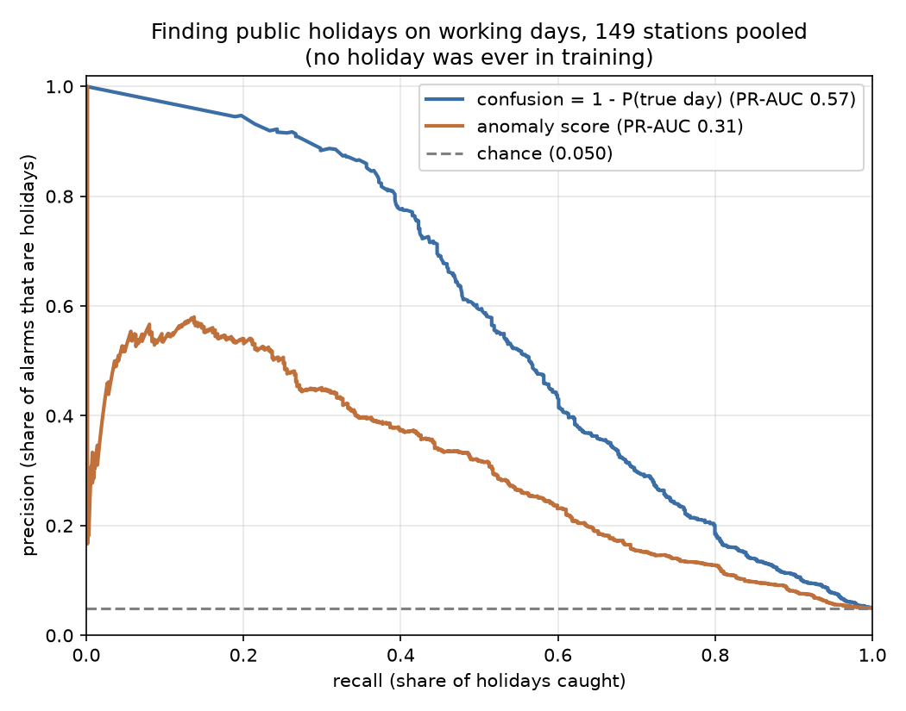

**Why precision looks low.** Holidays are only ~4% of days, and the threshold flags
~5% of normal days by design. So even a perfect detector at this threshold would raise
more false alarms than it catches holidays. PR-AUC doesn't depend on the threshold, so
it is the fairer comparison.

**Lockdown, reported separately** (share of days flagged):

| Days | Confusion | Anomaly |
|---|---|---|
| Normal | 5.3% | 5.3% |
| Public holiday | **57.7%** | 41.1% |
| Christmas season | 18.0% | 11.2% |
| Lockdown | 21.3% | **27.6%** |

The two detectors are good at different things:
- **Confusion is better for holidays.** A holiday looks like a *familiar* day (Sunday)
  on the wrong date.
- **Anomaly is better for lockdown.** Lockdown looks like *no* familiar day. This is the
  same lesson as the negative result below.

### The 20 most confusing days per showcase city

Outside lockdown, each day was checked against the holiday calendar, then against news
for the clusters that had a candidate explanation (`outputs/tables/top_confusion_days.csv`;
news checks with sources in `config/event_checks.csv`):

| City | Verified holiday | Festive season | Plausible event (sourced) | Unexplained |
|---|---|---|---|---|
| New York | 3 | 4 | 1 | 12 |
| Athens | 5 | 4 | 0 | 11 |
| Brussels | 4 | 2 | 1 | 13 |

**In each city's top five,** every explained day is a holiday or Christmas-season day:
5/5 in New York and Athens, 3/5 in Brussels.

**The two sourced events:**
- **New York, Fri 29 Nov 2019:** the day after Thanksgiving, which many employers give off.
- **Brussels, Fri 13 Mar 2020:** the day after Belgium announced its first COVID-19
  measures, days before the formal lockdown.

**What we looked for and did not find:**
- **Athens:** its 2019 general strike (20 Nov) is *not* in the top 20, and an earlier
  announced strike date (13 Nov) was moved.
- **Brussels:** no national strike between Nov 2019 and Feb 2020.

The 36 remaining days are reported as unexplained. Their confusion values (0.80–0.96)
sit around the 95th percentile of each city's normal days (0.85 New York, 0.85 Athens,
0.91 Brussels). By construction about 5% of normal days, roughly 5–6 per city, land
there anyway. So most unexplained days are probably ordinary days the model finds hard,
not missed events.

---

## Result 9 — Transfer across regions, and how it fails (`src/transfer.py`)

**Region matrix.** Train on one region, test on unseen stations of each region
(weekday vs weekend, balanced accuracy):

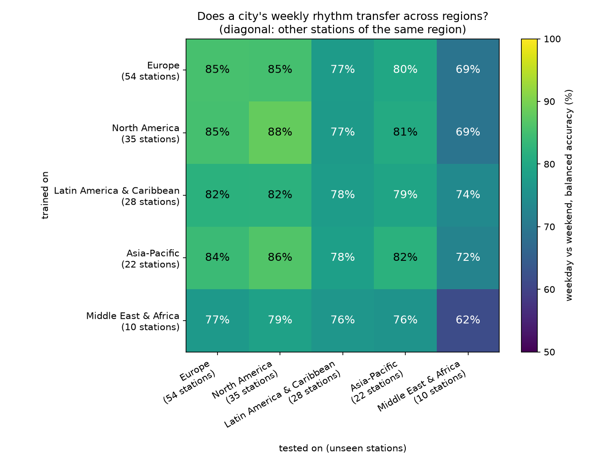

- **Columns matter more than rows.** How well a region is predicted depends mostly on
  the *test* region, not on which region trained the model:
  - Europe and North America are predicted at 77–88% from anywhere.
  - Middle East & Africa only at 62–74%, whoever trained the model.
- **Middle East & Africa is hardest even for itself (62%).** Its 10 stations mix
  Friday, Friday–Saturday and Saturday–Sunday weekends, so a pooled model has to learn
  several weekends from very few cities.

**Weekend-shift test** (n = 3, a case study). A model trained only on Saturday–Sunday
countries is shown the three Friday-weekend stations. Share of days called Saturday or
Sunday:

| Station | Thu | **Fri** | Sat | **Sun** |
|---|---|---|---|---|
| Salfit (Fri weekend) | 6% | **100%** | 53% | **12%** |
| Amatzia (Fri–Sat weekend) | 13% | **87%** | 100% | **7%** |
| Jeddah (Fri–Sat weekend) | 100% | 100% | 100% | 100% |

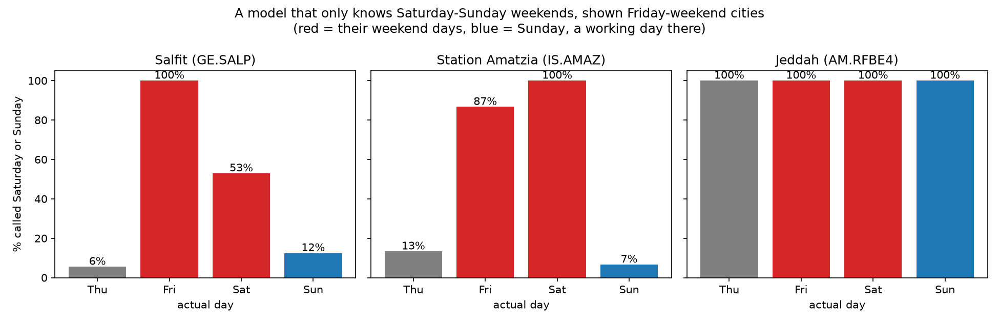

**Salfit and Amatzia behave exactly as hypothesised.** Their Fridays are called
weekend, and their Sundays are called a working day. The model recognises *rest*, not
the calendar name.

**Jeddah fails differently.** The model calls *every* Jeddah day a weekend (93–100% of
Mon–Sun). Its loudness does drop on Friday (median level z: −1.8 on Friday, −0.5 on
Saturday, +0.3 to +0.7 midweek), but its daily shape is unlike any Saturday–Sunday
training city. The cause is not established. A late daily schedule is one possibility,
but nothing here tests it.

**What goes with poor transfer?** This is each station's accuracy when it is unseen by
the pooled model (simple correlations, 149 stations):

| Station property | Association with transfer accuracy | p |
|---|---|---|
| Own-model accuracy (how clear its rhythm is) | ρ = +0.76 | 4 × 10⁻²⁹ |
| Population density | ρ = +0.27 | 0.001 |
| \|latitude\| | ρ = +0.25 | 0.002 |
| Share of days missing | ρ = −0.16 | 0.06 |
| Raspberry Shake vs professional | median 87.8% vs 90.0% | 0.4 |

The strongest predictor is simply how clear the station's own rhythm is.
- **Density** goes with better transfer, as with Result 2.
- **Higher latitude** also does. It is plausibly confounded with region (Europe and North
  America sit further from the equator); we did not separate the two.
- **Citizen sensors** transfer about as well as professional ones.

---

## Result 10 — The UAE weekend change, a pre-registered natural experiment

See [`14-uae-preregistration.md`](14-uae-preregistration.md). The hypothesis and test
were committed (`76d526f`) before any data was downloaded. The data is recent, from
EarthScope MUSTANG, and is never mixed with the Lecocq data.

On 1 Jan 2022 the UAE moved its weekend, and Sunday became a rest day. At the
seismometer in Sharjah (`II.UOSS.10.BHZ`):

| | Change vs Mon–Thu, after − before | p |
|---|---|---|
| **Sunday (primary, pre-registered)** | **−20%** | **0.003** (exact permutation, one-sided) |
| Sunday in the placebo year (2020-21) | +5% | 0.73 |
| Saturday (placebo day: rest day in both periods) | −3% | 0.52 |
| Friday (no directional prediction) | **+53%** | 3 × 10⁻⁶ |

**Pre-registered verdict: SUPPORTED.** The ground in Sharjah noticed the new weekend.

Friday was a surprise. We had predicted little change, because Sharjah's government and
schools still take Friday off. But Friday became 53% busier relative to Mon–Thu. That is
consistent with federal and private-sector Friday working, though one seismometer can't
say who.

> **Location correction (2026-11-04).** The station's official coordinates
> (24.9453° N, 56.2042° E) are ~90 km east of Sharjah city, in the Hajar mountains,
> although its site name is "Univ. of Sharjah". The Sunday result stands as measured
> at this sensor; which emirate's weekend rules apply around it is not verified, which
> matters for how Friday is read. Details: `docs/14`, section 7, Limits.

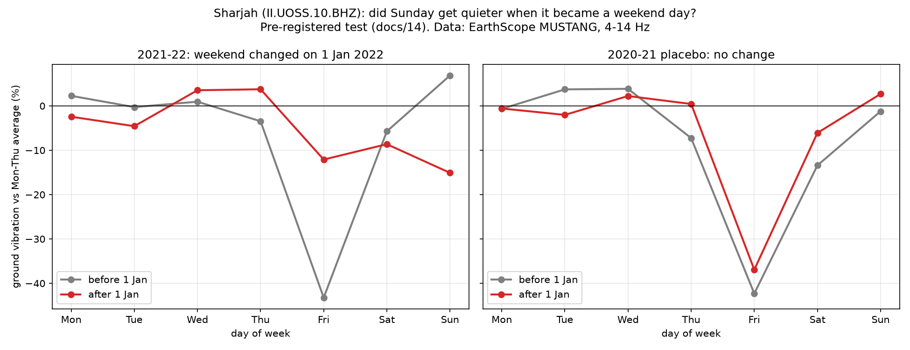

---

## Result 11 — Live models on 12 months of recent data (`src/train_live.py`)

The dashboard needs models that know what each city sounds like **now**, not in 2019.
So each live station in `config/stations.yaml` gets its own models, trained on
**1 Oct 2025 – 30 Sep 2026** of EarthScope MUSTANG data (Route A, validated in
Stage 3). Same features, same labelling rules (public holidays and 21 Dec – 6 Jan kept
out of training), same random forest, whole weeks held out. Weeks are grouped by year
*and* week number, because this data spans two years.

| City | Days | Normal days | Weekday vs weekend | Exact day | 2019–20 (published data) |
|---|---|---|---|---|---|
| Brussels | 359 | 332 | **100.0%** | 54.8% | 100% / 47.8% |
| Los Angeles | 362 | 337 | **99.3%** | 62.9% | 100% / 58.0% |
| Melbourne | 362 | 343 | **98.9%** | **74.9%** | 94.9% / 66.4% |
| Dublin | 364 | 341 | **98.6%** | 58.1% | 98.8% / 50.0% |
| Montreal | 221 | 202 | **97.6%** | 58.4% | 100% / 61.4% |
| Sharjah | 361 | 332 | 71.6% | 41.3% | not in the data |
| Puerto Williams (control) | 199 | 192 | 64.9% | 25.0% | 56.4% / 8.7% |

Chance is 50% for weekday vs weekend and 14.3% for the exact day.

What this shows:

- **The five validated cities work on current data**, at 97.6–100% for weekday vs
  weekend. Exact-day accuracy is higher than in 2019–20 at four of five, likely
  because there are ~3× more training days (about 48 of each weekday instead of 16).
  The 2019–20 column is context only: different source, different years, and no
  model ever saw both.
- **Melbourne names the exact day 74.9% of the time**, above any station in the
  published results (best: 73.9%).
- **Sharjah is harder (71.6%).** The labels follow the federal Saturday–Sunday weekend,
  but Sharjah's government and schools take Friday off too (Result 10), and the sensor
  is ~90 km east of the city (see the location correction there). The plot shows
  Friday has its own midday dip, so "weekend" here is genuinely mixed.
- **The control town is no longer at chance.** Puerto Williams scores 64.9%, above
  all 200 week-shuffled permutations (p = 0.005); in 2019–20 it was 56.4%. A weak
  weekly rhythm is present in 2025–26. One station can't say why, so we only report
  it. Its data has large gaps (Nov–Dec 2025 empty).
- **Gaps are shown, not hidden.** Montreal has almost no data for Feb–May 2026; the
  table in `outputs/tables/live_models.csv` counts months with fewer than 20 days.

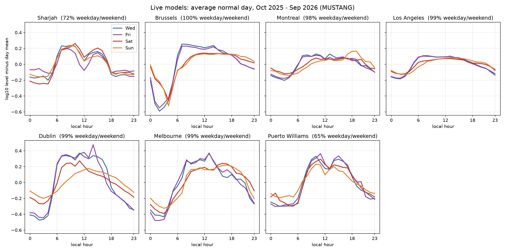

Reproduce: `python src/train_live.py` (first run downloads ~75 MB; cached after).
Every station-day is in `outputs/tables/live_days.csv`, and `tests/test_live.py`
checks that the scores above reproduce from it exactly.

---

## Result 12 — Which frequencies carry the rhythm? (`src/band_test.py`)

The published files contain only 4–14 Hz, but MUSTANG spectra contain every frequency.
So on the 7 live stations (same 12 months, same days per station, same model) we
rebuilt the features from five frequency bands:

| Band | What it is | Weekday vs weekend (median) | Exact day (median) |
|---|---|---|---|
| 0.1–1 Hz | ocean microseism: waves on coastlines | **51.4%** (chance) | 15.1% (chance) |
| 1–4 Hz | low end of cultural noise | 98.4% | 50.9% |
| **4–14 Hz** | **the band Lecocq et al. used** | **98.6%** | **58.1%** |
| 14–19.7 Hz | high end (top bin at 40 sample/s) | 95.3% | 56.6% |
| 1–19.7 Hz | everything above the microseism | 95.3% | 49.7% |

- **The natural control works.** Ocean waves have no weekly rhythm, and the model finds
  none there (45–59% at every station). The method reads people, not nature.
- **4–14 Hz is the best band overall**, which supports the paper's choice.
- **Dublin needs the narrow band.** It scores 98.6% at 4–14 Hz but **50.0% at 1–4 Hz and
  47.9% at 1–19.7 Hz**. Something steady at low frequency swamps the rhythm, and
  because displacement weights low frequencies by 1/f⁴, it also swamps the wide band.
- **Puerto Williams does best at 14–19.7 Hz** (74.6%): its human noise is local and
  high-pitched.

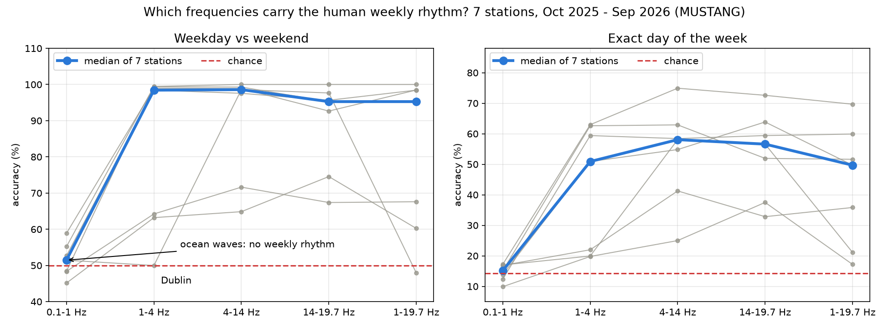

---

## Result 13 — City Pulse: the first month on days no model had seen

The dashboard (https://groundtruth-seismic.vercel.app/, `src/pulse.py`) scores every
day since the training window ended (1 Oct 2026). Snapshot of the run on
**2026-11-04** (`site/data/pulse.json`; the live page updates daily):

| City | New normal days | Weekday vs weekend | Exact day | Days flagged anomalous |
|---|---|---|---|---|
| Brussels | 32 | 100% | 56.2% | 3% |
| Los Angeles | 30 | 100% | 76.7% | 6% |
| Dublin | 32 | 100% | 53.1% | 9% |
| Melbourne | 31 | 100% | 77.4% | 6% |
| Montreal | 32 | 80.0% | 43.8% | **25%** |
| Puerto Williams (control) | 30 | 86.4% | 33.3% | 0% |
| Sharjah | 32 | 63.2% | 28.1% | 3% |

- **Dublin's October Bank Holiday (Mon 26 Oct 2026)** was called *Sunday*,
  P(weekend) 1.00, and flagged by both detectors. Puerto Williams' 12 Oct holiday was
  also called Sunday.
- **Montreal is drifting**: a quarter of its days are flagged (≈5% expected). Its
  training year misses Feb–May 2026. Canadian Thanksgiving (12 Oct) is also not marked
  as a holiday, because the national `holidays` calendar for Canada leaves it out.
- One month is a small sample; these numbers will move.

**18 predictions are pre-registered** in `config/predictions.csv` (commit `6294930`,
before the dates) and graded automatically on the dashboard: Thanksgiving and Christmas
should look like weekends, LA's Veterans Day should *not*, and the day after
Thanksgiving should be flagged.

---

## Result 14 — Seven years of history, and the lockdown seen twice

`src/history_pilot.py` downloads MUSTANG for the 7 live stations, **Jan 2019 – Sep
2026** (~500 MB compressed cache). Usable days: 2,656–2,825 per city, except Puerto
Williams (1,929; most of Jul 2020 – Oct 2021 is missing).

**The check, written down before downloading** (`docs/10`, commit `e6404c3`): the %
change in working-day vibration from early 2020 to the first 4 weeks of lockdown,
computed in each source separately, on the same dates. Pass = same sign, within 10
percentage points.

| City | Lockdown | Lecocq et al. (published) | MUSTANG (our live source) | Pass |
|---|---|---|---|---|
| Brussels | 14 Mar 2020 | −17.7% | −17.0% | yes |
| Montreal | 13 Mar 2020 | −19.3% | −19.5% | yes |
| Los Angeles | 20 Mar 2020 | −21.7% | −21.0% | yes |
| Dublin | 13 Mar 2020 | −40.6% | −40.7% | yes |
| Melbourne | 18 Mar 2020 | −12.7% | −12.9% | yes |
| Puerto Williams | 25 Mar 2020 | −43.2% | −43.4% | yes |

**6/6 pass; the largest gap is 0.7 points.** The two sources are processed by
different people with different code from the same instruments, so the live data
source reproduces the published lockdown effect. (Table:
`outputs/tables/history_lockdown_check.csv`.)

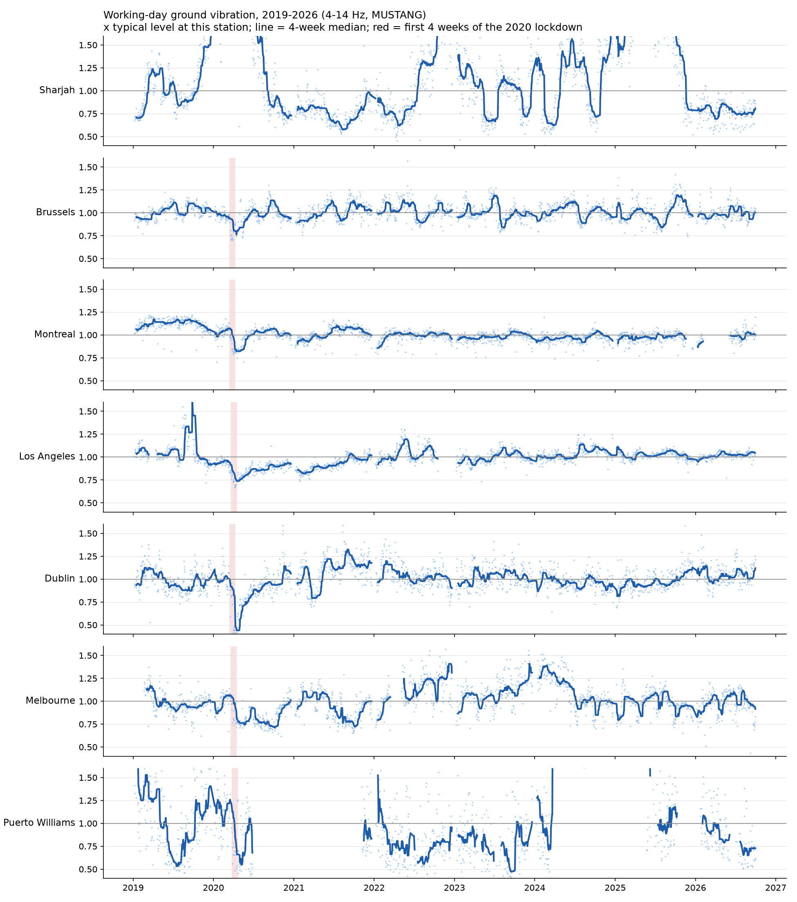

**What the plot also shows (exploratory, not part of the check):**
- Brussels, Montreal and Los Angeles dip in March 2020 and recover over months.
- Dublin and Melbourne show further long dips after 2020. These were not in the
  pre-written check and are not yet matched to sourced dates.
- **Sharjah's level jumps by 1.5× or more for months at a time** (2019–20, 2022,
  2024–25). That looks like site or instrument changes, not city life, so its raw
  level cannot be compared across years.
- Melbourne runs ~1.25× louder through 2022–24, again possibly local.

**Consequence for the planned globe:** a city's level over years mixes human activity
with slow changes at the site. Any multi-year colouring must compare each day with
recent weeks at the same station (or use the unit-free day shape), not with one fixed
year, and must say so on the page.

---

## Result 15 — Seven years, 33 cities: the time-travel globe

`src/history.py` extends the history to **33 stations**: every station of the published
study that MUSTANG served in both 2020 and 2026 (32), plus Sharjah. None was chosen by
its results; weak-signal towns are kept and shown faded. Jan 2019 – Sep 2026, 2.2 GB of
compressed spectra, 736–2,798 days with a value per station (`history_summary.csv`).

**The number on the globe** (fixed before the download, `groundtruth/history.py`): each
day's level vs the median of the **same weekday over the previous 8 weeks**, ordinary
days only. No model, no weekend definition, and slow site drift cancels out.

**Does it mean anything? Held-out check on public holidays** (holidays are never
reference days, and nothing was tuned on them):

| | Median change | ≥10% quieter |
|---|---|---|
| Weekday public holidays (median over 33 stations) | **−19.4%** | **83%** |
| Ordinary weekdays | 0.0% | 16% |

At 31 of 33 stations, the median holiday is quieter than the median ordinary weekday
(Shillong only just: −5.8%). The two exceptions: **La Paz** (+3.8%; a weak-signal
station, 54% in the published study) and **Cojutepeque, El Salvador, where holidays are
14% *louder*** although the weekly rhythm is clear there (86%).
We cannot explain Cojutepeque; local festivities are a guess, not a finding.

**The lockdowns, as synchrony.** Of the 24 clearly-measured cities (published accuracy
≥ 80%), the number 15%+ quieter than their recent normal: **5** on Mon 16 Mar 2020,
**12** on Mon 23 Mar, **17** on Mon 30 Mar. Christmas Day 2020: 19 of 22 with data.
New Year's Day 2025: 19 of 21.

**Coordinates.** Table S1 places Nilore (II.NIL) 13,737 km away, in Paraguay, and Davao
(IU.DAV) 808 km away, in Malaysia; the FDSN station service agrees with Table S1 within
0.6 km for the other 31. The globe and the research map now use the station service.
The density correlation (Result 2) barely moves without these two (ρ 0.389 → 0.385).

**Labels.** The coordinates are where the *sensor* is; Table S1's names are cities, and
some sensors are far from theirs. Rule, fixed before measuring (`src/check_places.py`,
GeoNames gazetteer): more than 20 km from the named city, or a name that is not a place,
gets an honest website label, "Site (near City)". 6 of the 33 globe stations are more
than 20 km from their named city, plus 2 names that are not GeoNames places
("Connecticut", the misspelt "Joinvile"). (IU.DAV's "Dabaw" also shows as "Davao".)
Four sensors that sit outside their city stay under the line and keep its name: Mount
Kent 14 km from Stanley, Calan 12 km from Santiago, Chestnut Hill 9.5 km from Boston,
Pallekele 7.8 km from Kandy.

| Station | Table S1 name | Sensor → that city | Website label |
|---|---|---|---|
| II.UOSS | Sharjah | 90.7 km | Hajar Mts (near Kalba), 19 km |
| BL.VABB | Sao Paulo | 69.4 km | Valinhos (near Campinas), 15 km |
| S1.AUKSC | Melbourne | 24.2 km | Keysborough (near Melbourne) |
| GT.LPAZ | La Paz | 23.7 km | Near La Paz |
| II.NNA | Lima | 21.2 km | Nana (near Lima) |
| IU.OTAV | Otavalo | 20.9 km | Near Otavalo |
| ON.TIJ01 | Joinvile | — | Tijucas do Sul (near Joinville), 48 km |
| NE.WSPT | Connecticut | — | Westport (near Bridgeport), 12 km |

Sharjah's vault sits 284 m up in the Hajar mountains, at one position since 2009 (every
FDSN epoch agrees); "Univ. of Sharjah" in its site name is the operator. A rural vault
may be part of why its weekly rhythm is weak (71.6%, Result 11). The published tables and
all analyses keep Table S1's names; only the website labels change. Seychelles, Cape
Verde, Bermuda and Nilore are not GeoNames city matches but are named in the station's
own site name, so they keep their names.

**Limits.** Europe is thin (European stations are archived by EIDA, not MUSTANG). The
8-week reference makes long events fade and makes recoveries look loud. National holiday
calendars only. The history stops at 30 Sep 2026; newer days are on City Pulse.

## Result 16 — Ask the ground: every city-day, 2019–2026, guessed out of fold

`src/ask.py` (method in `groundtruth/ask.py`) gives the website's **Ask** page
(`globe.html#ask`) a guess for every day it can show. It covers the same 33 stations and
the same MUSTANG data as Result 15, from 1 Jan 2019 to 30 Sep 2026.

**Method, fixed before running:**
- **Model:** one 7-class random forest per station (`make_model()`), on the usual 25
  features. The 24-hour shape, plus `level`: the day's loudness as a robust z-score
  against the station's ordinary days in the **previous 8 weeks**. That keeps seven years
  of sensor drift out of the feature. It needs at least 10 such days; deep in the 2020
  lockdown window there are none, so a day then uses the last 28 ordinary days before it
  (within a year). This fallback was added after review found 60% of lockdown days had no
  guess.
- **Training days:** ordinary days only. Public holidays, 21 Dec – 6 Jan, and a fixed
  lockdown window, **1 Mar – 30 Jun 2020** (every station), are never trained on.
- **Testing:** 5-fold GroupKFold by year-aware `week_id`. Every day, including the
  holidays and lockdown days that never enter training, is guessed by the fold model that
  did not see its week. A test checks that every week sits in exactly one fold
  (`tests/test_ask.py`).

**Results** (`outputs/tables/ask_scores.csv`): 82,120 days guessed, 72,759 of them
ordinary days, and all 3,757 days of the lockdown window.

| | Median over 33 stations |
|---|---|
| Exact weekday (chance 14%) | **47.4%** |
| Weekday vs weekend, balanced | **93.1%** (20 stations at 90% or better) |
| Weekday public holidays read as a weekend | **67%** at the median station (58.9% of all 2,112) |
| Ordinary weekdays read as a weekend | 1.7% at the median station (1.8% of all) |

The best: Brussels 99.6% weekday vs weekend (and 98% of its weekday holidays read as a
weekend), Hobart 99.5%, Dublin 99.0%, Montreal 99.0%. The worst are where they should
be: the control towns sit at chance, Stanley at 51% and Puerto Williams at 57%. So do La
Paz (50%, a one-day-weekend city) and Nilore (57%). These match the published study's
weak stations (Result 1).

**Limits.**
- One model per station spans seven years, so sensor swaps sit inside the training data.
- Later regional lockdowns (Melbourne 2020–21, and others) are not marked, so some of
  their days were trained on.
- Holidays come from national calendars only.
- Sharjah's weekend moved on 1 Jan 2022. The 7-class model does not depend on it, but
  its weekday-vs-weekend score uses the rule in force on each date (70.2%).
- A training day's `level` is measured against earlier days, some of which can sit in
  another fold's test weeks. No labels are shared, but the folds are not perfectly independent.
- This is a separate evaluation from Results 1 and 11, with different data, years and
  level reference. Its numbers are not comparable one to one.

Run: `python src/ask.py` (about 10 min, from the local MUSTANG cache).

## Result 17 — Naming the exact weekday: richer features, then a week of context

Pre-registered in `docs/15-weekday-preregistration.md` (commit `7cc7497`) before anything ran;
`src/weekday_experiment.py`, `groundtruth/weekday.py`. Same 33 stations, years, labels and
honesty rules as Result 16; 72,395 ordinary days scored by every configuration.

**Why:** Result 16 names the exact weekday at only 47%, with Tuesday to Thursday near chance.
The team's goal was 90%.

| | median exact weekday (33 stations) | Tue-Thu | stations at 90%+ |
|---|---:|---:|---:|
| Result 16 features, one day (A0-RF) | 47.5% | 24.7% | 0 |
| **Part A**: 3 bands (1-4, 4-14, 14-20 Hz) x 48 half-hours, gradient boosting, one day | **56.7%** | 31.5% | 0 |
| **Part B**: the same features for the **7 days around** the day | **96.1%** | 96.0% | 25 |

- Part A improves on Result 16 by +9.2 points at the median and at 33 of 33 stations (the
  pre-registered bar was +3 points at 22 stations). It was chosen among 8 configurations on the
  same data, so it is slightly optimistic. From one day, Tuesday to Thursday stay hard.
- Part B reaches the 90% aspiration: pooled, each weekday is right 91-92% of the time. It
  answers a different question ("given the week around it, which day is the middle one?"):
  the model finds the weekend and counts. Folds are 28-day blocks, and training days whose
  window touches a test block are dropped. The same single-day features on those folds
  (control B0) score 54.7%, so the gain comes from the week.
- Weakest stations (Part B): Stanley 30.9%, Puerto Williams 62.7%, near La Paz 64.6%, Nilore
  65.9%: the quiet, remote places that are near chance in every result.

Run: `python src/weekday_experiment.py` (about 40 min from the local MUSTANG cache; day tables
are cached in `data/cache/weekday/`).

---

## An honest negative result

**Lockdown did not make every day look like a Sunday.**

| Days | Weekdays classified "weekend" | Days flagged as anomalous |
|---|---|---|
| Lockdown | 26% | 35% |
| Public holidays | 76% | 46% |

So a lockdown day was flagged as unusual more often than it was called a weekend.

**Why.** A holiday looks like a weekend because people genuinely do weekend things. A
lockdown created something new: much quieter overall, with a flattened, home-bound daily
shape that matches neither a weekday nor a weekend.
- The **anomaly detector**, which just measures "unlike normal", catches it.
- The **weekday/weekend classifier**, which must choose one of two familiar patterns,
  does not.
- Result 8 shows the same split between the two detectors.

This is worth saying out loud in the presentation. It shows the difference between
supervised classification and unsupervised anomaly detection, and it's a more
interesting finding than a clean win would have been.

---

## Limitations

- **Short baseline.** ~115 normal days per station. That is thin for a 7-class problem
  and is probably the main ceiling on the day-of-week accuracy.
- **One season.** The Lecocq data covers Nov 2019 – May 2020 only, so seasonal effects
  are confounded with everything else.
- **National holidays only.** Public holidays use national calendars. Regional ones
  (Swiss cantonal, US state, ...) are not removed from training. See
  `docs/03-methodology.md`.
- **Weekend labels involve judgement.** "Sunday only" for India, Mexico, Hong Kong,
  Bolivia and Honduras follows the cited source, but many offices there also close on
  Saturday.
- **Some one-day-weekend stations show no weekly signal** (La Paz and three Nepal
  stations), even with class weighting.
- **The decomposition is kept for comparability, not accuracy.** Raw hourly values do
  slightly better per station (Result 6).
- **Most top-confusion days are unexplained.** Only clusters with a candidate
  explanation were checked against news.
- **Small groups.** Middle East & Africa has 10 stations, the weekend-shift test has 3,
  and the UAE experiment uses 1 station.
- **The Lecocq data ends in mid-2020.** The UAE experiment uses recent MUSTANG data;
  everything else does not.

---

## Cross-country weekend signature

A sceptic could argue that any weekly pattern is just *a* pattern. To check that it is
specifically human, we applied the same processing, unchanged, to countries that rest
on different days. This section involves no machine learning — it is medians of the
published recordings.

For every station with at least 40 pre-lockdown days, we took the median 4–14 Hz RMS
per day in local time, then the median per day-of-week, normalised to that station's
busiest day. Scoring every adjacent two-day pair gives an inferred weekend.

**156 stations qualified.** 132 are quietest on Sunday. Five are quietest on Friday.

| Country | City | Days | Fri | Sat | Sun |
|---|---|---:|---:|---:|---:|
| State of Palestine | Salfit | 142 | **0.498** | 0.631 | **0.983** |
| Israel | Station Amatzia | 123 | **0.757** | 0.755 | **0.951** |
| Saudi Arabia | Jeddah | 124 | **0.887** | 0.919 | **0.966** |
| Pakistan | Nilore | 114 | 0.860 | 0.889 | 0.906 |
| Nepal | Myagdi | 137 | 0.770 | 0.546 | 0.838 |

Israel, Palestine and Saudi Arabia all observe a Friday–Saturday weekend, with Sunday a
full working day. The seismic profile reflects exactly that. Salfit is clearest:
activity falls to half on Friday and returns to 98% of peak by Sunday.

Median normalised Sunday activity: **0.966** for those three stations, **0.683** for the
other 153. Mann-Whitney U, one-sided: p = 0.0032.

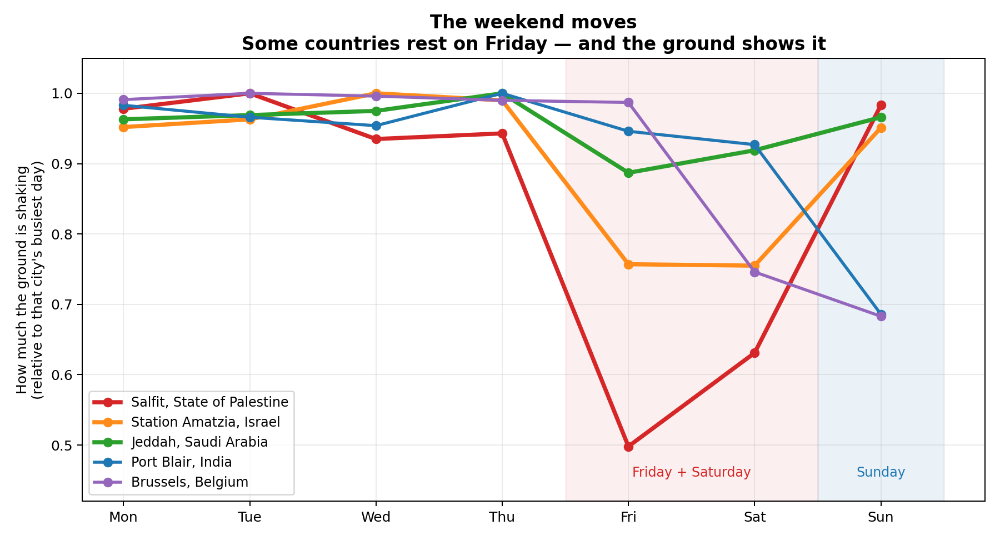

### Limitations of this section

- **n = 3** for the Fri–Sat group. The direction and effect size are the claim; the
  p-value rests on three stations.
- **Nepal is a metric artifact.** Nepal's weekly holiday is Saturday alone. Because
  Friday happens to sit below Sunday at Myagdi, the adjacent-pair metric labels it
  Fri–Sat. The other two Nepal stations correctly return Saturday.
- **Pakistan is a genuine middle case.** The cited source lists a Monday–Friday
  workweek with many businesses open Saturday, and Friday shows a dip, plausibly the
  Friday prayer break.
- **Station count differs from the headline 158** because this analysis uses
  pre-lockdown days only and requires >=40 days per station. The 158 figure describes
  the full modelling dataset; 156 describes this analysis. They measure different
  things.
- **Date parsing matters here.** `Table S1` uses dd/mm/yyyy. Pandas' default parse
  reads "08/03/2020" as 3 August 2020, months after the recordings end, which
  silently disables the pre-lockdown trim for any date whose day and month are both
  <= 12. `weekend_signature.py` forces `dayfirst=True`. The result is unchanged either
  way — the same five Friday stations appear — but the day counts differ.

Reproduce with `python src/weekend_signature.py`.
