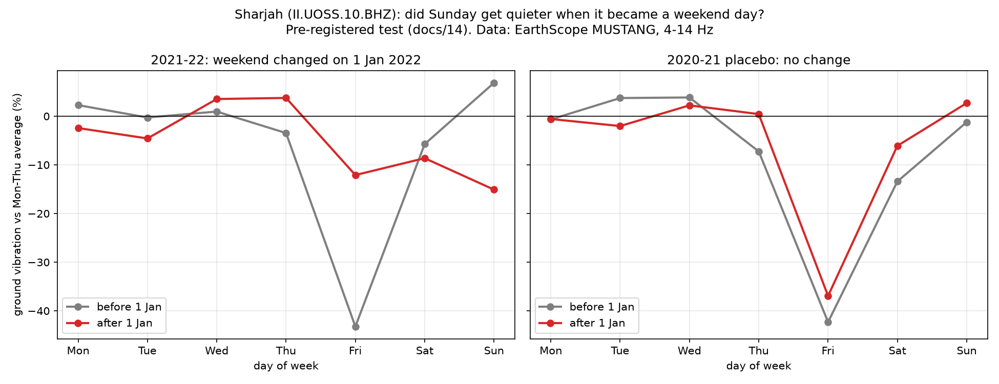

# 14. Pre-registration: did Sharjah's ground vibration notice the new weekend?

**Written 2026-11-04, before downloading any of the data it analyses.** This file is
committed to git on its own, *before* the analysis script fetches anything, so the
commit history proves the question was fixed before the answer was seen. After that
commit, nothing in sections 1–6 changes. Anything decided later is labelled
**exploratory** in the results.

## Why pre-register?

With enough freedom (which months, which days, which statistic) almost any dataset
can be made to "show" an effect. Writing the exact test down first removes that
freedom. A null result is then a real result, and it will be reported as one.

## 1. The natural experiment

From **1 January 2022** the UAE moved its official weekend:

| | Before (until 31 Dec 2021) | After (from 1 Jan 2022) |
|---|---|---|
| UAE federal government | Fri–Sat weekend | Mon–Thu full days, **Friday half day**, Sat–Sun weekend |
| **Sharjah** government and schools | Fri–Sat weekend | Mon–Thu, **Fri–Sat–Sun weekend** |

Sources:
- Wikipedia, *Workweek and weekend*, revision 1381808266 (see `docs/02`) for the
  federal change.
- Gulf News, *Sharjah to get four-day workweek with Friday, Saturday and Sunday as
  weekends*, 9 Dec 2021 —
  https://gulfnews.com/uae/government/sharjah-to-get-four-day-workweek-with-friday-saturday-and-sunday-as-weekends-1.1639045271093
- Gulf Today, *All Sharjah schools to have Friday, Saturday and Sunday as weekend*,
  12 Dec 2021 —
  https://gulftoday.ae/news/2021/12/12/all-sharjah-schools-to-have-friday-saturday-and-sunday-as-weekend
- UAE government portal, working hours in the public sector —
  https://u.ae/en/information-and-services/jobs/Sector-of-employment/working-in-uae-government-sector/working-hours-in-the-public-sector

The station is `II.UOSS.10.BHZ` in Sharjah. Its data have never been examined for this
question. The only UOSS data downloaded before this file is 3 hours of 10 Jan 2022
(`tests/fixtures/`, a unit-conversion test), which says nothing about weekdays.

**The one prediction both calendars agree on:** **Sunday** was a working day before
and is a rest day after. Saturday was a rest day in both periods. Friday was a rest day
before; after the change it is a rest day for Sharjah and a half day federally, so it is
not predicted to change much.

## 2. Data and measurement (fixed)

- **Source:** EarthScope MUSTANG noise-psd, `II.UOSS.10.BHZ`, converted to 4–14 Hz
  displacement RMS by `groundtruth/mustang.py` (validated in Stage 3), then glitch
  filter `clean_rms`.
- **Local time:** `Asia/Dubai`. Daily features come from `groundtruth.features.daily_features`
  (needs ≥ 20 of 24 hours).
- **Daily activity A(d)** = `level_raw`, the day's mean of the 24 hourly log10 medians.
- **Main window:** Mon 2021-10-04 to Sun 2022-03-27 (Ramadan 2022 starts after it).
- **Change date:** 2022-01-01.
- **Excluded days:**
  1. UAE public holidays (`holidays` 0.108, country `AE`): 2021-10-21, 2021-12-01/02/03,
     2022-01-01.
  2. The school winter break and switch-over, **2021-12-12 to 2022-01-02**, inclusive.
     The federal calendar gives the break as 12–30 Dec 2021; schools resumed 2–3 Jan.
     Source: Khaleej Times, *New UAE school calendar announced* —
     https://www.khaleejtimes.com/uae/government/new-uae-school-calendar-announced-here-are-the-holidays

## 3. The test (fixed)

- **Unit = one Monday-to-Sunday week.** A week counts if it has its Sunday and at least
  2 of its Mon–Thu days after exclusions. Weeks before the change are "before"; weeks
  after it are "after". No week straddles the change, because the switch-over week is
  excluded.
- **Per week:** S(w) = A(Sunday) − mean A(Mon–Thu).
- **Primary statistic:** Δ_Sun = mean S over *after* weeks − mean S over *before* weeks.
- **Hypothesis (one-sided):** Δ_Sun < 0. Sunday becomes quieter relative to Mon–Thu
  once it is a rest day.
- **Test:** exact permutation test. Every way of relabelling the weeks as before/after
  (same group sizes) gives a null distribution. p = share of relabellings with a Δ as
  low as or lower than the observed one. α = 0.05.
- **Effect size:** Δ_Sun in log10 units, also as a percentage change (10^Δ − 1).

## 4. Checks fixed in advance

1. **Is there a weekly rhythm at all? (gatekeeper)** In the before weeks, compute the
   mean of [mean A(Fri, Sat) − mean A(Mon–Thu)]. If it is not below 0, this sensor does
   not see the weekend. The experiment is then declared **uninformative**, with no
   conclusion either way.
2. **Placebo day: Saturday.** Same statistic with Saturday in place of Sunday. A rest
   day in both periods, so predicted ≈ 0. Reported two-sided.
3. **Placebo year.** The whole analysis shifted exactly 52 weeks earlier:
   - window 2020-10-05 to 2021-03-28;
   - "change" date 2021-01-02;
   - excluded block 2020-12-13 to 2021-01-03, plus UAE holidays.

   No weekend change happened then, so Δ_Sun is predicted ≈ 0. This guards against a
   seasonal or school-term effect that would also be there every year. Caveat: COVID-19
   rules in winter 2020–21 differ from 2021–22.
4. **Friday:** same statistic, reported two-sided, with no directional prediction.

## 5. Decision rules (fixed)

| Gatekeeper | Primary p | Placebo-year p (one-sided, same direction) | Conclusion |
|---|---|---|---|
| fails | — | — | Uninformative: the sensor shows no weekly rhythm |
| passes | < 0.05 | ≥ 0.05 | **Supports** the hypothesis: the ground noticed the new weekend |
| passes | < 0.05 | < 0.05 | Inconclusive: a seasonal pattern can't be ruled out |
| passes | ≥ 0.05 | any | **Not supported**, reported as a null result |

The window, metric, station and exclusions will not be changed after seeing the data.

## 6. Exploratory (after the primary result, labelled as such)

- Hour-by-hour shape of Fridays before vs after: does a federal half day show up as a
  busier Friday morning?
- The same analysis without the excluded school-break block.
- Data quality: how many weeks survive the rules.

## 7. Results (added 2026-11-04, after the pre-registration commit `76d526f`)

Produced by `python src/uae_experiment.py`. Tables are in `outputs/tables/uae_experiment.csv`.

### Pre-registered verdict: **SUPPORTED**

| Check | Weeks (before / after) | Change vs Mon–Thu, after − before | p |
|---|---|---|---|
| Gatekeeper: Fri+Sat below Mon–Thu before the change? | before weeks only | −0.125 log10 (≈ −25%) | passes |
| **Primary: Sunday** | 9 / 12 | **−0.099 log10 (−20%)** | **0.003** (one-sided, exact, 293,930 relabellings) |
| Placebo year: Sunday, 2020-21 | 8 / 12 | +0.022 (+5%) | 0.73 (one-sided) |
| Placebo day: Saturday | 10 / 12 | −0.012 (−3%) | 0.52 (two-sided) |
| Friday (no directional prediction) | 9 / 12 | **+0.186 (+53%)** | 3 × 10⁻⁶ (two-sided) |

**In plain words:**
- **Before 1 Jan 2022,** the ground in Sharjah was quietest on Friday (43% below Mon–Thu).
  Sunday was a normal working day.
- **After,** Sunday dropped to 15% below Mon–Thu, which is a 20% change.
- **Placebo year:** the same calendar window a year earlier shows nothing like it.
- **Placebo day:** Saturday, a rest day in both periods, did not change.

### The surprise: Friday

The pre-registration said Friday was "not predicted to change much". **That was wrong.**
Friday got 53% busier relative to Mon–Thu, the largest change of any day. This is
consistent with a federal and private-sector working (half) day replacing a full rest
day, even though Sharjah's own government and schools take Friday off. We can't tell
from one seismometer *who* is now active on Fridays.

### Exploratory (not pre-registered for testing)

| Check | Result |
|---|---|
| Friday hour by hour (`outputs/plots/uae_friday_hours.png`) | 08–12 h was −70% vs Mon–Thu before, −23% after. 14–18 h was −55% before, −20% after. The whole Friday got busier, not only the morning; this one sensor shows no clear half-day signature. |
| The dip at 13:00 on post-change Fridays | Falls in the Friday-prayer window. But Sharjah did **not** move its prayer time when the rest of the UAE moved to 13:15 (Khaleej Times, *New UAE weekend: Friday prayer timings in Sharjah to remain unchanged*, Dec 2021). So we don't interpret it. |
| School-break exclusion removed | Sunday −20%, p = 0.0008. Same conclusion. |

### Limits

- **Where the sensor is (found 2026-11-04, after the analysis).** The FDSN station
  service names the site "Univ. of Sharjah, Sharjah", but gives coordinates
  24.9453° N, 56.2042° E for every sensor epoch: about 90 km **east** of Sharjah city,
  in the Hajar mountains. We have not verified which emirate that point is in. The
  pre-registered test (Sunday vs Mon–Thu) does not depend on this; the *reading* of
  Friday does, since "Sharjah's government takes Friday off" only applies if the
  sensor's surroundings follow Sharjah's rules.
- **One station,** one change.
- **Short "before" period.** Only 9–10 weeks (Oct–Dec 2021).
- **Expo 2020 Dubai** (Oct 2021 – Mar 2022) spans both periods, so it can't explain a
  switch exactly at 1 Jan; but it is a busy background.
- **The placebo year was a COVID-19 winter.** Restrictions in winter 2020–21 were
  different from those in 2021–22.
